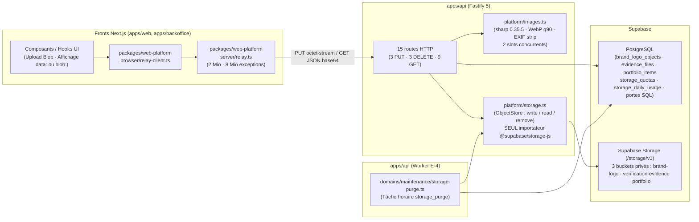
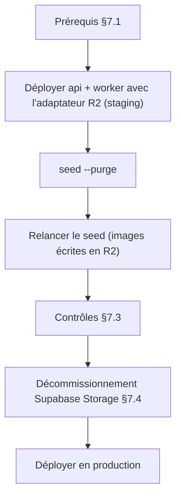

# Audit — Stockage des images utilisateur (migration Supabase Storage → Cloudflare R2)

> **Date :** 2026-11-26  
> **Objet :** Cartographier de manière exhaustive tous les points du projet où les images téléversées par les utilisateurs sont reçues, validées, enregistrées, référencées en base, lues, supprimées, purgées et testées, afin de préparer le remplacement de **Supabase Storage** par **Cloudflare R2** (API S3 privée, palier gratuit 10 Go, juridiction `eu` en production) tout en conservant **Supabase** pour tout le reste (PostgreSQL, rôles/RLS, migrations, Supabase Auth / GoTrue).

---

## 1. Synthèse exécutive

### 1.1 Périmètre constaté

À ce jour, **100 % des objets stockés dans Supabase Storage sont des images téléversées par les utilisateurs**, toutes ré-encodées côté serveur en **WebP sans métadonnées** via `sharp`. Aucun autre type de fichier (PDF, vidéo, document bureautique, export RGPD) n'utilise Supabase Storage.

Le stockage repose sur **3 compartiments (buckets) privés** :

| Bucket actuel | Domaine métier | Qui dépose | Qui lit | Limite reçue (passe-plat) | Limite stockée (WebP) | Dimensions | Quota quotidien (UTC / compte) |
|---|---|---|---|---|---|---|---|
| `brand-logo` | Logo de marque annonceur | Annonceur | Annonceur propriétaire, créateur (campagnes ouvertes), backoffice (file 1) | 2 Mio (`2 097 152` o) | 1 Mio (`1 048 576` o) | Carré `512 × 512` (min côté ≥ 256 px, `fit: contain`, alpha) | 10 dépôts / 20 Mio |
| `verification-evidence` | Captures d'écran d'audience créateur (badge vérifié) | Créateur | **Backoffice uniquement** (files 4 & contestations, verrou actif + journalisé) | 8 Mio (`8 388 608` o) | 8 Mio (`8 388 608` o) | Non redimensionné (320 à 16 383 px, ≤ 4 096² px) | 18 dépôts / 64 Mio (max 6 pièces / demande) |
| `portfolio` | Visuels du portfolio créateur | Créateur | Créateur propriétaire (+ aperçu), marque (recherche/profil anonyme, visuels `approved` seuls), backoffice (files 2 & 3, verrou actif + journalisé) | 8 Mio (`8 388 608` o) | 8 Mio (`8 388 608` o) | Non redimensionné (320 à 16 383 px, ≤ 4 096² px) | 16 dépôts / 64 Mio (max 8 places / créateur) |

### 1.2 Points d'architecture favorables à la migration

1. **Un unique adaptateur Supabase Storage dans tout le code applicatif :** `apps/api/src/platform/storage.ts` est le **seul** fichier autorisé à importer `@supabase/storage-js` (verrouillé par ESLint et test statique `apps/api/tests/supabase-guards.test.ts`).
2. **Une interface abstraite déjà en place (`ObjectStore`) :** tout le backend (`server.ts`, `worker.ts`, services métiers, purge horaire) dépend uniquement de 3 primitives : `write()`, `read()`, `remove()`.
3. **Zéro couplage côté frontends (`apps/web` et `apps/backoffice`) :** conformément aux décisions **D80** et **D82**, aucune URL Supabase, aucun jeton et aucune clé Storage ne quitte `apps/api`. Les dépôts transitent en binaire brut (`application/octet-stream`) par le passe-plat Next.js (`packages/web-platform/src/server/relay.ts`) et les lectures sont relayées en JSON (`base64`) par `apps/api`.
4. **Séparation stricte avec le reste de Supabase :** Supabase Auth (`@supabase/auth-js` dans `apps/api/src/platform/supabase.ts`) et PostgreSQL (`postgres` / `drizzle-orm` dans `apps/api/src/db/`) sont totalement découplés de `storage.ts`. Les variables `SUPABASE_URL` et `SUPABASE_SECRET_KEY` restent nécessaires pour GoTrue, mais peuvent être dissociées du stockage d'images.

### 1.3 Flux futurs (spécifiés, non encore implémentés) et hors périmètre

- **Futur Lot 4 (`introduction-documents`) :** cité dans `docs/mvp/04-modele-de-donnees-mvp.md` §5.11 et `docs/mvp/12-messagerie-a-trois.md` (RG68). Si activé après arbitrage D30/Q4, ce canal n'acceptera également que des **images** (PNG, JPEG, WebP — pas de PDF).
- **Futur `legal-documents` :** mentionné dans `04` §5.11 mais aucun bucket n'existe en base (les CGU sont publiées en PostgreSQL via `apps/api/scripts/publish-terms.ts`).
- **Hors périmètre (ne pas migrer) :**
  - Images statiques de la vitrine (`apps/web/src/content/images/*.jpg`, `apps/web/src/content/landing-images.ts`), servies directement par Next.js.
  - Captures d'audit UX (`docs/audit-ux-ui/captures/*.jpg`).
  - Supabase Auth / GoTrue, PostgreSQL, RLS, Drizzle, outbox et worker hors tâche `storage_purge`.

### 1.4 Recommandation de périmètre (complément du 2026-11-26)

- **Migrer uniquement le stockage physique** ; le référencement (`object_key` SQL) et la distribution (relais JSON base64 par `apps/api`) restent inchangés (§6).
- **Aucune reprise de données** : les environnements ne contiennent que des données de test reproductibles, dont la perte est acceptée. La bascule se résume à changer d'adaptateur, purger les comptes du seed (`--purge`) et relancer le seed (§7).
- Points à traiter en plus de l'inventaire : RGPD et sous-traitance Cloudflare, sauvegarde, orphelins, décision formelle, exploitation (§8).

---

## 2. Architecture actuelle du flux d'images

### Cycle de vie standard d'un dépôt (commun aux 3 flux)

1. **Contrôle & réservation en base (avant tout décodage) :** vérification session/rôle, prise d'un des 2 slots `ImageSlots`, incrémentation du quota journalier (`profiles.storage_daily_usage`), insertion de la ligne en état `pending` (ou `uploading` pour `portfolio`) qui **génère automatiquement `object_key` en SQL**.
2. **Validation et ré-encodage en mémoire (`platform/images.ts`) :** lecture des magic bytes (PNG/JPEG/WebP), vérification dimensions/pixels (≤ 4 096²), ré-orientation EXIF, suppression totale des métadonnées (EXIF, XMP, IPTC, ICC → sRGB), encodage WebP q90. En cas de refus : suppression de la ligne `pending`/`uploading` (`discard_*`), HTTP `422 image_rejected`.
3. **Écriture binaire (`ObjectStore.write`) :** envoi vers Supabase Storage sous `object_key` (`upsert: false`). En cas d'échec : passage de la ligne à `purging` (`fail_*`), HTTP `503`.
4. **Activation en base :** passage à `active` / `in_review` (logo) ou `pending` file 3 (portfolio), stockage de `byte_size`, `width`, `height`, `checksum` (SHA-256 pour preuves et portfolio), et marquage de l'éventuel objet remplacé en `purging`.
5. **Suppression immédiate « au mieux » + purge horaire :** `removeAtBest()` tente `ObjectStore.remove()` immédiatement (sauf retrait de portfolio, conservé 30 jours en état `withdrawn`). Tout échec, abandon (> 15 min), échéance de rétention ou effacement RGPD (`privacy.execute_request`) est rattrapé toutes les heures par la tâche E-4 `storage_purge`.

---

## 3. Inventaire exhaustif des emplacements dans le projet

### 3.1 Plateforme stockage, traitement d'images et configuration (`apps/api`)

| Fichier | Rôle exact | Détails / Lignes clés | Impact migration Cloudflare R2 |
|---|---|---|---|
| `apps/api/src/platform/storage.ts` | **Adaptateur unique** `@supabase/storage-js` | `STORAGE_BUCKETS`, `STORAGE_READ_MAX_BYTES`, `OBJECT_KEY_PATTERNS`, `ObjectStore`, `createObjectStore()` (l. 1–222) | **Point de remplacement central** : implémenter l'adaptateur Cloudflare R2 (requêtes S3 signées SigV4 via `node:crypto` + `boundedFetch`) derrière la même interface `ObjectStore` (`write`, `read`, `remove`). |
| `apps/api/src/platform/images.ts` | Pipeline `sharp` (validation magic bytes, resize logo 512², WebP q90, strip EXIF/ICC/XMP) | `reencodeLogo`, `reencodeEvidence`, `reencodePortfolio`, `createImageSlots` (l. 1–305) | **Aucun changement** : garantit T9.4 et T9.5 (strip EXIF avant envoi R2) ; les bornes actuelles (jusqu'à 16 383 px et 8 Mio) restent 100 % compatibles avec R2. |
| `apps/api/src/server.ts` | Instanciation de `objectStore` et injection dans les routes | Import l. 59 ; `createObjectStore(config.supabase)` l. 601 ; injection l. 610, 626, 645, 664, 673, 720 | Injecter le nouvel adaptateur instancié depuis `config.r2` (ou `config.objectStorage`). |
| `apps/api/src/worker.ts` | Instanciation de `objects` pour la purge horaire E-4 | Import l. 92 ; `createObjectStore(config.supabase)` l. 409 ; `createStoragePurge` l. 211 | Instancier le nouvel adaptateur R2 pour le worker (séparé de `config.supabase` qui reste utilisé par `createGoTrueUserDirectory`). |
| `apps/api/src/config/schema.ts` | Validation des variables d'environnement (`api` et `worker`) | `SUPABASE_URL`, `SUPABASE_SECRET_KEY` (l. 88–135, 315, 402–413, schémas API & Worker) | Ajouter les variables R2 (`R2_ENDPOINT`, `R2_ACCESS_KEY_ID`, `R2_SECRET_ACCESS_KEY`, `R2_BUCKET_PREFIX` optionnel) dans `api` et `worker`. Garder `SUPABASE_*` pour GoTrue. |
| `apps/api/.env.example` | Documentation des variables d'environnement | Section Supabase l. 70–81 | Documenter les nouvelles variables R2 (serveur uniquement, jamais `NEXT_PUBLIC_`). |
| `apps/api/package.json` | Dépendances NPM de `@influx/api` | `"@supabase/storage-js": "2.117.2"` (l. 32), `"sharp": "0.35.5"` (l. 37) | Retirer `@supabase/storage-js` une fois la migration terminée (zéro nouvelle dépendance NPM nécessaire si signature AWS SigV4 via `node:crypto` + `fetch` Node 24). |
| `apps/api/eslint.config.mjs` | Garde d'imports par fichier | `SUPABASE_BUT_STORAGE` l. 26–41, bloc `src/platform/storage.ts` l. 259–262 | Mettre à jour la règle ESLint : interdire `@supabase/storage-js` partout (seul `@supabase/auth-js` reste autorisé dans `src/platform/supabase.ts`). |

---

### 3.2 Routes HTTP, services et repositories backend (`apps/api/src/domains/`)

#### A. Logo de marque — bucket `brand-logo`

| Couche | Fichier | Route / Symbole | Opération Storage |
|---|---|---|---|
| Routes membre | `apps/api/src/domains/profiles/routes.ts` | `GET /v1/me/brand-profile/logo` `PUT /v1/me/brand-profile/logo` (2 Mio, `octet-stream`) `DELETE /v1/me/brand-profile/logo` | Délègue à `brand-logo.ts` |
| Service membre | `apps/api/src/domains/profiles/brand-logo.ts` | `BRAND_LOGO_BUCKET = "brand-logo"` (l. 47) `uploadBrandLogo()` (l. 129) `readBrandLogo()` / `readPendingLogo()` (l. 277, 306) `removeBrandLogo()` / `removeAtBest()` (l. 105, 347) | `store.write` (l. 193) `store.read` (l. 284, 320) `store.remove` (l. 110, 244) |
| Repository membre | `apps/api/src/domains/profiles/repository.ts` | `beginBrandLogoUpload`, `discardBrandLogoUpload`, `failBrandLogoUpload`, `activateBrandLogo`, `removeOwnBrandLogo`, `readOwnActiveLogo`, `readOwnInReviewLogo` (l. 533–656) | Manipule `object_key` renvoyé par les portes SQL `profiles.*` |
| Route créateur (campagnes) | `apps/api/src/domains/search/open-campaigns/routes.ts` | `GET /v1/open-campaigns/:id/brand-logo` (l. 174–225) | `store.read("brand-logo", row.objectKey)` (l. 200) |
| Repository campagnes | `apps/api/src/domains/search/open-campaigns/repository.ts` | `callOpenCampaignLogoDoor()` (l. 50–65) | Appelle `search.read_open_campaign_brand_logo()` → `object_key` |
| Route backoffice (file 1) | `apps/api/src/domains/backoffice/queues-logo-routes.ts` | `GET /v1/bo/queues/profiles-advertiser/entries/:id/logo?logo=<id>` (l. 46–136) | `store.read("brand-logo", object.objectKey)` (l. 109) |
| Route parent backoffice | `apps/api/src/domains/backoffice/queues-routes.ts` | `registerBackofficeQueueRoutes()` (l. 51, 97) | Transmet `store` aux sous-routes (file 1, 2, 3, 4, contestations) |
| Repository backoffice | `apps/api/src/domains/backoffice/queues/repository.ts` | `readReviewLogo()` (l. 902–920) | Appelle `profiles.read_advertiser_review_logo()` → `object_key` |

#### B. Pièces de vérification — bucket `verification-evidence`

| Couche | Fichier | Route / Symbole | Opération Storage |
|---|---|---|---|
| Routes créateur | `apps/api/src/domains/verification/routes.ts` | `PUT /v1/me/verification/requests/:id/evidence` (8 Mio, `octet-stream`) `DELETE /v1/me/verification/requests/:id/evidence/:evidenceId` | Délègue à `evidence.ts` (note : le créateur ne relit jamais ses pièces) |
| Service créateur | `apps/api/src/domains/verification/evidence.ts` | `EVIDENCE_BUCKET = "verification-evidence"` (l. 51) `uploadEvidence()` (l. 107) `removeEvidence()` / `removeAtBest()` (l. 84, 258) | `store.write` (l. 172) `store.remove` (l. 89) |
| Repository créateur | `apps/api/src/domains/verification/repository.ts` | `beginEvidenceUpload`, `discardEvidenceUpload`, `failEvidenceUpload`, `activateEvidence`, `removeOwnEvidence` | Manipule `object_key` renvoyé par `verification.*` |
| Garde backoffice file 4 | `apps/api/src/domains/backoffice/verification-queues/guards.ts` | `VerificationQueuesDependencies` (`store: ObjectStore`, l. 17–21) | Propagation de `store` |
| Route backoffice file 4 | `apps/api/src/domains/backoffice/verification-queues-decision-routes.ts` | `GET /v1/bo/queues/verification-creators/entries/:id/evidence/:evidenceId` (l. 540–590) | `store.read("verification-evidence", read.key)` (l. 558) |
| Repository file 4 | `apps/api/src/domains/backoffice/verification-queues/repository.ts` | `readEvidenceKey()` (l. 1073–1081) | Appelle `verification.read_evidence()` → `object_key` (et journalise `verification.evidence_viewed`) |
| Route backoffice contestations | `apps/api/src/domains/backoffice/verification-disputes-routes.ts` | `GET /v1/bo/queues/verification-disputes/entries/:id/evidence/:evidenceId` (l. 669–718) | `store.read("verification-evidence", read.key)` (l. 687) |
| Repository contestations | `apps/api/src/domains/backoffice/verification-disputes/repository.ts` | `readDisputeEvidenceKey()` (l. 445–454) | Appelle `verification.read_dispute_evidence()` → `object_key` |

#### C. Portfolio créateur — bucket `portfolio`

| Couche | Fichier | Route / Symbole | Opération Storage |
|---|---|---|---|
| Routes créateur | `apps/api/src/domains/profiles/creator/routes.ts` | `PUT /v1/me/creator-profile/portfolio[?replaces=<uuid>]` (8 Mio, `octet-stream`) `GET /v1/me/creator-profile/portfolio/:id/image` `DELETE /v1/me/creator-profile/portfolio/:id` | Délègue à `portfolio.ts` |
| Service créateur | `apps/api/src/domains/profiles/creator/portfolio.ts` | `PORTFOLIO_BUCKET = "portfolio"` (l. 73) `uploadPortfolioItem()` (l. 227) `readPortfolioImage()` (l. 466) `removePortfolioItem()` (l. 436, rétention 30j) / `removeAtBest()` (l. 205) | `store.write` (l. 293) `store.read` (l. 477) `store.remove` (l. 209) |
| Repository créateur | `apps/api/src/domains/profiles/creator/portfolio/repository.ts` | `beginPortfolioUpload`, `discardPortfolioUpload`, `failPortfolioUpload`, `storePortfolioItem`, `readOwnPortfolioObject`, `removeOwnPortfolioItem` (l. 50–58, 215–230) | Manipule `object_key` de `profiles.portfolio_items` |
| Route marque (recherche) | `apps/api/src/domains/search/creator-search-profile/routes.ts` | `GET /v1/creator-search/profiles/:alias/visuals/:visualId` (l. 157–178) | Délègue à `creator-search-profile.ts` |
| Service marque (recherche) | `apps/api/src/domains/search/creator-search-profile/creator-search-profile.ts` | `readCreatorVisual()` (l. 104–131) | `store.read("portfolio", object.objectKey)` (l. 117) |
| Repository marque (recherche) | `apps/api/src/domains/search/creator-search-profile/repository.ts` | `callCreatorVisualDoor()` (l. 39–50) | Appelle `search.read_creator_visual()` → `object_key` |
| Routes backoffice (files 2 & 3) | `apps/api/src/domains/backoffice/creator-queues-routes.ts` | `GET /v1/bo/queues/profiles-creator/entries/:id/portfolio/:itemId/image` (l. 625–667) `GET /v1/bo/queues/portfolio-moderation/entries/:id/image` (l. 841–880) Helper `relayedImage()` (l. 369–406) | `store.read("portfolio", object.objectKey)` (l. 378) |
| Repository backoffice (files 2 & 3) | `apps/api/src/domains/backoffice/creator-queues/acts/repository.ts` | `readCreatorEntryItem()`, `readPortfolioItem()` (l. 186–235) | Appelle `profiles.read_creator_review_portfolio_item()` et `profiles.read_portfolio_item_for_review()` → `object_key` |

#### D. Purge asynchrone et maintenance (`worker`)

| Fichier | Rôle exact | Détails |
|---|---|---|
| `apps/api/src/domains/maintenance/storage-purge.ts` | Tâche périodique horaire `storage_purge` (E-4) | Réclame jusqu'à 10 × 100 lignes en `purging` (ou `pending`/`uploading` > 15 min, ou échéances `retention_due_at`), appelle `objects.remove(candidate.bucket, candidate.objectKey)`, puis valide en base via `completeStoragePurges()`. Code d'échec : `storage.remove_failed`. |
| `apps/api/src/domains/maintenance/repository.ts` | Pont SQL pour la purge | `claimStoragePurges()` (l. 190–211) filtre `bucket_id` contre `STORAGE_BUCKETS` ; `completeStoragePurges()` (l. 217–227) ; `purgeStorageUsage()` (purge des quotas journaliers > 7 jours). |

---

### 3.3 Base de données PostgreSQL, schémas Drizzle et migrations (`supabase/`)

#### A. Tables stockant les références d'images et quotas

| Table SQL | Schéma Drizzle | Colonne clé objet | État / Cycle de vie |
|---|---|---|---|
| `profiles.brand_logo_objects` | *(non déclarée dans `profiles.ts`, gérée via portes SQL)* | `object_key text GENERATED ALWAYS AS (account_id::text \|\| '/' \|\| id::text \|\| '.webp') STORED` | `pending` → `active` / `in_review` → `purging` → ligne supprimée à la purge |
| `verification.evidence_files` | `apps/api/src/db/schema/verification.ts` (l. 203–225) | `object_key text GENERATED ALWAYS AS (account_id::text \|\| '/' \|\| request_id::text \|\| '/' \|\| id::text \|\| '.webp') STORED` | `pending` → `active` → `purging` → `purged` (ligne + checksum SHA-256 conservés 3 ans, RG86) |
| `profiles.portfolio_items` | *(gérée via portes SQL)* | `object_key text GENERATED ALWAYS AS (account_id::text \|\| '/' \|\| id::text \|\| '.webp') STORED` | `uploading` → `pending` → `approved` / `rejected` / `withdrawn` → `purging` → `purged` (ligne conservée, légende vidée) |
| `profiles.storage_quotas` | *(SQL)* | `bucket_id` (`'brand-logo'`, `'verification-evidence'`, `'portfolio'`) | Quotas par jour UTC (indépendant du fournisseur de stockage) |
| `profiles.storage_daily_usage` | *(SQL)* | `(account_id, bucket_id, usage_day)` | Compteur journalier purgé après 7 jours (indépendant du fournisseur) |

#### B. Migrations Supabase liées au stockage

| Migration | Contenu lié à Supabase Storage / images |
|---|---|
| `supabase/migrations/0204_profiles_brand_logo_storage.sql` | Crée le bucket `storage.buckets` `'brand-logo'` (privé, 1 Mio, `image/webp`) ; crée les politiques **restrictives** `influx_no_member_access` sur `storage.objects` et `storage.buckets` (P10.6) ; crée `profiles.brand_logo_objects`, `profiles.storage_quotas`, `profiles.storage_daily_usage` et les 5 portes SQL (`begin_brand_logo_upload`, `discard_brand_logo_upload`, `fail_brand_logo_upload`, `activate_brand_logo`, `remove_own_brand_logo`) ; étend `privacy.execute_request()` ; assertions finales sur `storage.buckets` et `storage.objects`. |
| `supabase/migrations/0205_ops_storage_purge.sql` | Crée la tâche E-4 `storage_purge` et les fonctions `ops.claim_storage_purges()`, `ops.complete_storage_purges()`, `ops.purge_storage_usage()`. |
| `supabase/migrations/0209_profiles_brand_freeze_and_revision_door.sql` | Étend `profiles.activate_brand_logo()` et `profiles.remove_own_brand_logo()` pour les révisions (`in_review`) sur profil publié. |
| `supabase/migrations/0213_profiles_brand_logo_agent_read.sql` | Crée `profiles.read_advertiser_review_logo()` + assertion qu'aucun rôle applicatif n'a de privilège direct sur `storage.objects`. |
| `supabase/migrations/0215_profiles_brand_review_owner_and_lock.sql` | Met à jour `profiles.read_advertiser_review_logo()` (contrôle conflit d'intérêts RG36). |
| `supabase/migrations/0221_verification_core.sql` | Crée `verification.evidence_files` (colonne générée `object_key`). |
| `supabase/migrations/0223_verification_evidence_storage.sql` | Crée le bucket `storage.buckets` `'verification-evidence'` (privé, 8 Mio, `image/webp`) ; ajoute son quota ; crée les portes `verification.{begin,discard,fail}_evidence_upload`, `activate_evidence`, `remove_own_evidence`, `follow_request_evidence` ; étend `ops.claim_storage_purges()` et `ops.complete_storage_purges()` ; assertions sur `storage.buckets`/`storage.objects`. |
| `supabase/migrations/0224_verification_claims_and_decisions.sql` | Crée `verification.read_evidence()` (renvoie `object_key` au détenteur du verrou et journalise `verification.evidence_viewed`). |
| `supabase/migrations/0232_verification_badge_disputes.sql` | Crée `verification.read_dispute_evidence()` (renvoie `object_key` en contestation). |
| `supabase/migrations/0242_profiles_portfolio_items.sql` | Crée le bucket `storage.buckets` `'portfolio'` (privé, 8 Mio, `image/webp`) ; ajoute son quota ; crée `profiles.portfolio_items` (colonne générée `object_key`) et ses portes (`begin_portfolio_upload`, `discard_portfolio_upload`, `fail_portfolio_upload`, `store_portfolio_item`, `reorder_own_portfolio`, `remove_own_portfolio_item`, `withdraw_portfolio_of_former_creator`) ; met à jour `ops.claim_storage_purges()` et `ops.complete_storage_purges()` pour les 3 buckets ; assertions sur `storage.buckets`/`storage.objects`. |
| `supabase/migrations/0243_profiles_creator_submission.sql` | Porte `profiles.set_own_portfolio_caption()`. |
| `supabase/migrations/0244_profiles_creator_review_decisions.sql` | Portes backoffice `profiles.read_creator_review_portfolio_item()` et `profiles.read_portfolio_item_for_review()`. |
| `supabase/migrations/0306`, `0310`, `0314`, `0318`, `0325` | Reconduisent dans `privacy.execute_request()` le passage en `purging` des 3 tables (`brand_logo_objects`, `evidence_files`, `portfolio_items`) lors d'un effacement RGPD. |
| `supabase/migrations/0314_search_open_campaigns.sql` | Crée `search.read_open_campaign_brand_logo()` (renvoie `object_key` du logo actif d'une campagne ouverte). |
| `supabase/migrations/0323_search_creator_profile_door.sql` & `0327_search_doors_hide_an_exclusion.sql` | Crée/met à jour `search.read_creator_visual()` (renvoie `object_key` d'un visuel `approved` pour une marque). |
| `supabase/config.toml` | Section `[storage]` (l. 124–143 : `enabled = true`, `file_size_limit = "50MiB"`, `s3_protocol.enabled = true`). Aucun bucket déclaré dans `config.toml` (tous créés par migrations). |

> **Attention migrations immuables :** les anciennes migrations (`0204`, `0223`, `0242`) ne doivent **pas** être réécrites si la base est déjà déployée ; une nouvelle migration dédiée se chargera des évolutions de colonnes/portes SQL (et de l'éventuel décommissionnement ultérieur des buckets Supabase).

---

### 3.4 Passe-plat, contrats et frontends (`packages/`, `apps/web`, `apps/backoffice`)

#### A. Passe-plat & contrats partagés

| Fichier | Rôle | Impact migration |
|---|---|---|
| `packages/web-platform/src/server/relay.ts` | Passe-plat Next.js (`/api/v1/…` → `apps/api/v1/…`), empreinte SHA-256 épinglée (PP-12). `MAX_BODY_BYTES = 2 Mio` (l. 36) ; `BODY_LIMIT_EXCEPTIONS = 8 Mio` pour `PUT …/evidence` et `PUT …/portfolio` (l. 44–59). | **Aucun changement** si l'upload reste relayé par `apps/api`. |
| `packages/web-platform/src/browser/relay-client.ts` | Client navigateur unique (`callRelay`). Envoie `Blob` en `application/octet-stream` (l. 109–141). | **Aucun changement** en mode relais API. |
| `packages/contracts/src/brand-profile.ts` | Constantes logo (`BRAND_LOGO_MAX_UPLOAD_BYTES`, `BRAND_LOGO_MAX_STORED_BYTES`, `BRAND_LOGO_SIDE`) et schéma `brandLogoSchema` (`contentType`, `width`, `height`, `byteSize`, `data` base64). | **Aucun changement** (relais JSON conservé). |
| `packages/contracts/src/creator-portfolio.ts` | Constantes portfolio (`PORTFOLIO_MAX_SIDE = 16383`, `PORTFOLIO_MAX_STORED_BYTES = 8 Mio`) et `portfolioImageResponseSchema`. | **Aucun changement** (R2 supporte sans limite les WebP jusqu'à 16 383 px). |
| `packages/contracts/src/verification.ts` | Constantes pièces (`VERIFICATION_EVIDENCE_MAX_SIDE = 16383`, `VERIFICATION_EVIDENCE_MAX_UPLOAD_BYTES = 8 Mio`) et `verificationEvidenceReadResponseSchema`. | **Aucun changement**. |
| `packages/contracts/src/backoffice-queues.ts`, `creator-queues.ts`, `open-campaigns.ts`, `creator-search-profile.ts` | Schémas de réponse des routes de lecture d'images (tous en JSON `base64`). | **Aucun changement** (mode relais JSON conservé ; URL présignée S3 optionnelle plus tard pour logos/portfolios uniquement). |

#### B. Application membre (`apps/web`)

| Flux | Client API | Hook / État | Composants d'affichage / upload | Rendu actuel |
|---|---|---|---|---|
| Logo de marque (éditeur) | `apps/web/src/components/brand-profile/brand-profile-api.ts` | `use-brand-logo.ts` | `LogoField.tsx`, `BrandProfileScreen.tsx`, `BrandHome.tsx`, `member/ui/LogoPlate.tsx` | `data:image/webp;base64,…` |
| Logo de marque (aperçu campagne) | `brand-profile-api.ts` (`readBrandLogo`) | `campaign/use-campaign-preview.ts` | Écrans aperçu campagne marque | `data:image/webp;base64,…` |
| Logo de marque (fil créateur) | `apps/web/src/components/campaign/open-campaigns-api.ts` (`readOpenCampaignBrandLogo`) | `use-open-campaign-record.ts` | `CampaignFeedCard.tsx` (l. 32–56), fiche campagne ouverte | `data:image/webp;base64,…` |
| Portfolio créateur (éditeur & aperçu) | `apps/web/src/components/creator-profile/creator-portfolio-api.ts` | `use-creator-portfolio.ts`, `use-creator-preview.ts` | Écrans profil créateur & aperçu public | `data:image/webp;base64,…` |
| Portfolio créateur (recherche marque) | `apps/web/src/components/creator-search/creator-search-api.ts` (`readCreatorVisual`) | `use-card-visuals.ts` (`useVisualImages`, `useCardVisuals`) | Cartes recherche créateurs (`CreatorSearchScreen.tsx`), liste restreinte (`ShortlistScreen.tsx`), `AnonymousProfileScreen.tsx` | `data:image/webp;base64,…` |
| Pièces de vérification créateur | `apps/web/src/components/verification/verification-api.ts` (`uploadEvidence`, `removeEvidence`) | `use-audience-journey.ts` | `AudienceScreen.tsx` | Upload/suppression uniquement (aucun affichage de la pièce) |
| CSP & Next config | `apps/web/src/config/security-headers.ts` (l. 29–31) `apps/web/next.config.ts` (l. 29) | — | `img-src 'self' data: blob:`, `connect-src 'self'`, **pas de `images.remotePatterns`** | **Aucun changement** en relais JSON (à ouvrir uniquement si passage ultérieur à des URLs présignées R2). |

#### C. Application backoffice (`apps/backoffice`)

| Flux | Client API | Hook / Composant | Rendu actuel |
|---|---|---|---|
| Logo marque (file 1) | `apps/backoffice/src/components/backoffice-api.ts` (`readBrandReviewLogo`) | `use-review-logo.ts`, `ReviewLogo.tsx` | Décodage base64 → `URL.createObjectURL(blob)` (`blob:`) |
| Visuels portfolio (files 2 & 3) | `backoffice-api.ts` (l. 1230, 1387) | `CreatorVisual.tsx` (l. 99), `PortfolioReviewEntryScreen.tsx`, `PortfolioReviewBlocks.tsx` | Décodage base64 → `URL.createObjectURL(blob)` (`blob:`) |
| Pièces vérification (file 4 & contestations) | `backoffice-api.ts` (l. 886, 1036) | `use-verification-evidence.ts` (l. 77), `VerificationEvidenceBlocks.tsx`, `VerificationEntryScreen.tsx` | Décodage base64 → `URL.createObjectURL(blob)` (`blob:`) |
| CSP & Next config | `apps/backoffice/src/config/security-headers.ts` (l. 28–29) | — | `img-src 'self' blob:`, `connect-src 'self'`. **Ne pas assouplir** pour les pièces de vérification (T9.2, J3S-7). |

---

### 3.5 Scripts opérateurs, CI/CD, déploiement et tests

#### A. Script opérateur contournant `platform/storage.ts` (POINT D'ATTENTION CRITIQUE)

- **`apps/api/scripts/seed-staging-fake-profiles.ts`** (l. 77–78, 128–165, 315, 493, 553, 641) :
  - Appelle **directement** l'API REST Supabase Storage `${supabaseUrl}/storage/v1/object/${bucket}/${key}` (fonctions `putObject()` et `removeObjects()`) pour peupler en `staging` les 100 créateurs (bucket `portfolio`) et 50 marques (bucket `brand-logo`).
  - **À migrer impérativement** vers Cloudflare R2 (en réutilisant l'adaptateur `createObjectStore` ou la signature S3 R2) pour que le seed de `staging` continue de fonctionner.

#### B. CI/CD et Déploiement

- **`.github/workflows/ci.yml`** :
  - Lignes 237–245 (job `db`) et 352 / 384 (job `e2e`) : démarrent le conteneur `storage-api` de Supabase (excluant `imgproxy`, `realtime`, etc.) et vérifient `GET http://127.0.0.1:54321/storage/v1/status`.
  - Une fois Supabase Storage remplacé et les tests migrés sur une doublure R2 S3 locale, `storage-api` pourra être ajouté à `-x` dans `supabase start` (économie d'une image de ~1,3 Go et de 30–60 s par exécution CI).
- **`deploy/railway/{api,worker}{,.production}.json`** : aucun réglage Storage dans les JSON, mais les **variables d'environnement Railway** des services `api` et `worker` (en `staging` et en `production`) devront recevoir les identifiants R2 (`R2_ENDPOINT`, `R2_ACCESS_KEY_ID`, `R2_SECRET_ACCESS_KEY`, `R2_BUCKET_PREFIX`).

#### C. Tests et gardes statiques couplés à Supabase Storage

| Fichier | Nature du couplage | Action attendue lors de la migration |
|---|---|---|
| `apps/api/tests/supabase-guards.test.ts` | Exige `@supabase/storage-js` version exacte `2.117.2` (l. 76–83) et vérifie que `src/platform/storage.ts` est son seul importateur (l. 92–96). | Retirer `@supabase/storage-js` de la liste blanche et vérifier qu'il est absent du dépôt (ou l'ajouter à `FORBIDDEN_PACKAGES` dans `packages/test-kit/src/static/forbidden-packages.ts`). |
| `apps/api/tests/images.test.ts` | Garde statique sur `src/platform/storage.ts` vérifiant `upsert: false` et l'absence de `createSignedUrl`/`getPublicUrl`/`list` (l. 498–505). | Adapter la garde statique à l'implémentation R2 S3 (vérifier `If-None-Match: *` pour éviter l'écrasement, absence de présignature/listing, contrôle de clé `isObjectKey`). |
| `apps/api/db-tests/tm1-storage-purge.test.ts` | Teste la purge horaire E-4 contre le **vrai Supabase Storage local** (`createObjectStore`). | Basculer vers une doublure HTTP S3 locale (modèle `packages/test-kit/src/gotrue-double.ts`). |
| `apps/api/db-tests/profiles-brand-logo-route.test.ts` | Utilise `createObjectStore` contre le vrai Storage local (l. 238). | Basculer sur la doublure R2 S3. |
| `apps/api/db-tests/profiles-portfolio-route.test.ts` | Utilise `createObjectStore` contre le vrai Storage local (l. 370). | Basculer sur la doublure R2 S3. |
| `apps/api/db-tests/verification-evidence-route.test.ts` | Utilise `createObjectStore` contre le vrai Storage local (l. 397). | Basculer sur la doublure R2 S3. |
| `apps/api/db-tests/verification-evidence.test.ts` | Vérifie `storage.buckets` + utilise `createObjectStore` local (l. 231, 251, 277, 732). | Basculer sur la doublure R2 S3 ; adapter les vérifications `storage.buckets`. |
| `apps/api/db-tests/profiles-brand-logo.test.ts` | Vérifie les limites de `storage.buckets` `'brand-logo'` et les politiques `storage.objects`/`storage.buckets` (l. 195–315). | Conserver les tests de non-accès à `storage.objects`/`storage.buckets` (défense en profondeur P10.6), adapter les vérifications de buckets si supprimés. |
| `apps/api/db-tests/profiles-portfolio.test.ts` | Vérifie `storage.buckets` `'portfolio'` (l. 249). | Idem. |
| `apps/api/db-tests/t9-evidence-unreachable.test.ts` | Vérifie T9.6 : aucun bucket public, aucun droit `influx_advertiser` sur `storage.objects`/`storage.buckets`, et aucun hôte Storage dans les réponses (l. 426, 977–1029, 1141–1170). | Conserver T9.6 sur `storage.*` et étendre la détection de fuite d'hôte aux domaines R2 (`r2.cloudflarestorage.com`, `r2.dev`). |
| `apps/api/db-tests/creator-profile-door.test.ts` | Vérifie l'absence d'accès direct à `storage.objects` (l. 700). | Conserver tel quel. |
| Autres `db-tests/*` (`campaign-feed-route`, `creator-profile-route`, `t1-anonymisation`, `t14-*`) | Injectent un mock en mémoire implémentant `ObjectStore`. | **Aucun changement** si l'interface `ObjectStore` est préservée. |
| `packages/test-kit/src/rights/expected-rights.ts` | Matrice attendue des droits Postgres (incluant `object_key` et les fonctions `ops.*_storage_purges`). | **Aucun changement** (le schéma SQL `object_key` et les portes SQL restent identiques). |

---

## 4. Points critiques et adéquation technique avec Cloudflare R2

### 4.1 Pourquoi Cloudflare R2 s'aligne directement sur l'architecture existante

À la différence de Cloudflare Images, **Cloudflare R2** est un stockage objet compatible S3 avec des buckets privés :

1. **Aucune modification du schéma PostgreSQL :** les 3 buckets (`brand-logo`, `verification-evidence`, `portfolio`), la génération SQL de `object_key` (`<account_id>/<id>.webp` et `<account_id>/<request_id>/<id>.webp`), les tables de quotas/usage (`storage_quotas`, `storage_daily_usage`), les portes SQL et `ops.claim_storage_purges()` restent **strictement inchangés**.
2. **Conservation de l'interface `ObjectStore` :** `write(bucket, key, bytes, contentType)`, `read(bucket, key)` et `remove(bucket, key)` gardent exactement la même signature dans `apps/api/src/platform/storage.ts`.
3. **Zéro impact sur les limites d'images :** R2 n'impose aucune contrainte de dimension (les limites WebP jusqu'à `16 383 px` et `8 Mio` restent intactes) et accepte les octets WebP déjà ré-encodés par `sharp` (garantissant T9.4 et T9.5).
4. **Zéro impact sur les fronts (`apps/web`, `apps/backoffice`), les CSP et les contrats :** en conservant le relais serveur (`apps/api` ↔ R2 via S3 privé), aucune URL R2 ni aucun jeton ne quitte `apps/api` (respect strict de **D80, D82, T9.2, T9.6**).
5. **Palier gratuit et coûts prévisibles :** 10 Go de stockage/mois gratuits, 1 million d'écritures (Class A), 10 millions de lectures (Class B) et **0 \$ de bande passante sortante (egress)**.
   > **Nuance :** en mode relais, l'egress R2 gratuit ne bénéficie qu'au trajet R2 → `apps/api`. Les octets servis aux navigateurs sortent par Railway (`api` puis `web`/`backoffice`), en base64 (+33 %), et restent facturés par Railway. L'avantage « egress gratuit » ne se concrétise qu'avec une distribution directe depuis R2 (voir §6).

### 4.2 État vérifié du compte Cloudflare R2 (`2026-11-26`)

Vérification effectuée en lecture seule sur le compte Cloudflare connecté (`979649256981c89d4aa5d555663eb77f`) :

| Environnement | Buckets créés | Juridiction | Accès public (`r2.dev`) | Endpoint S3 |
|---|---|---|---|---|
| **Staging / Bac à sable** | `influx-staging-brand-logo` `influx-staging-portfolio` `influx-staging-verification-evidence` | `default` | Désactivé (privé) | `https://979649256981c89d4aa5d555663eb77f.r2.cloudflarestorage.com` |
| **Production** | `influx-production-brand-logo` `influx-production-portfolio` `influx-production-verification-evidence` | **`eu`** (Union européenne) | Désactivé (privé) | `https://979649256981c89d4aa5d555663eb77f.eu.r2.cloudflarestorage.com` |

> **Conséquences pour la configuration (`apps/api/src/config/schema.ts`) :**
> - Prévoir un paramètre `R2_BUCKET_PREFIX` (ex. `influx-staging-` / `influx-production-`, ou vide par défaut) pour mapper les 3 noms logiques (`brand-logo`, `verification-evidence`, `portfolio`) vers les noms de buckets R2 de l'environnement.
> - Prévoir des tokens R2 distincts entre `api` et `worker` (et entre `staging` et `production`, règle **D70**), **au moindre privilège** : chaque token limité aux 3 buckets de son environnement ; `api` en lecture/écriture/suppression, `worker` en suppression seule si la granularité des permissions R2 le permet (sinon « Object Read & Write » limité aux buckets, à documenter comme écart). Les tokens des buckets `influx-production-*` doivent être émis pour la juridiction `eu` et utilisés avec l'endpoint `*.eu.r2.cloudflarestorage.com`.
> - Les buckets `influx-production-*` garantissent la résidence des données en **Union européenne (`eu`)** pour la conformité **D25 / RGPD** (notamment pour `verification-evidence`).

### 4.3 Contrat S3 Cloudflare R2 et détails d'implémentation

- **Authentification S3 (AWS Signature V4) sans dépendance externe :**
  - Les 3 opérations (`PUT /{bucket}/{key}`, `GET /{bucket}/{key}`, `DELETE /{bucket}/{key}`) peuvent être signées avec `node:crypto` (`createHmac`, `createHash`, région `auto`, service `s3`) et envoyées via `boundedFetch(STORAGE_CALL_TIMEOUT_MS)` — aucune dépendance `@aws-sdk/client-s3` nécessaire (respecte l'approche minimaliste de `apps/api`).
  - **Estimation réaliste :** le cœur SigV4 tient en ~60 lignes, mais l'adaptateur complet doit aussi couvrir : encodage canonique de l'URI (les clés `uuid/uuid.webp` sont sûres, mais l'encodage doit rester correct), en-têtes `x-amz-date` et `x-amz-content-sha256` (empreinte réelle du corps au `PUT`), extraction bornée du `<Code>` des réponses XML d'erreur, **lecture en flux bornée** (abandon dès que `STORAGE_READ_MAX_BYTES[bucket]` est dépassé, que `Content-Length` soit présent ou non), et des tests unitaires sur les **vecteurs de test officiels AWS SigV4**. Compter plutôt ~200 lignes + tests.
- **Sémantique des 3 gestes `ObjectStore` :**
  - `write(bucket, key, bytes, "image/webp")` : `PUT /{r2Bucket}/{key}` avec en-tête **`If-None-Match: *`** pour reproduire `upsert: false` (refus `412 Precondition Failed` si l'objet existe déjà).
    > **À prouver avant implémentation :** le support de `If-None-Match: *` sur `PutObject` par R2 doit être constaté par un test réel contre un bucket `influx-staging-*` (écriture, réécriture de la même clé → `412` attendu). La doublure locale (§4.4) ne doit reproduire ce comportement qu'une fois constaté. À défaut, la garantie « jamais d'écrasement » repose uniquement sur l'unicité des clés générées en SQL (UUID), à documenter comme écart.
  - `read(bucket, key)` : `GET /{r2Bucket}/{key}` avec contrôle de taille `Content-Length` / buffer ≤ `STORAGE_READ_MAX_BYTES[bucket]`. `HTTP 404` (`NoSuchKey`) retourne `{ ok: true, value: null }` comme aujourd'hui.
  - `remove(bucket, key)` : `DELETE /{r2Bucket}/{key}`. En S3/R2, `DELETE` sur une clé absente renvoie `204 No Content` (et un éventuel `404` est traité comme succès idempotent pour la tâche `storage_purge`).
- **Logs & erreurs (D60) :** réduire toute erreur HTTP S3/R2 au statut HTTP et au code XML `<Code>` (`NoSuchKey`, `AccessDenied`, `PreconditionFailed`, etc.), sans jamais journaliser le message brut, la clé objet ni aucune signature.

### 4.4 Environnement local et CI (doublure HTTP S3)

- Contrairement à Supabase Storage (conteneur `storage-api`), la CI et les tests locaux peuvent s'appuyer sur une **doublure HTTP S3 locale** légère dans `packages/test-kit/src/` (modèle `gotrue-double.ts`), implémentant `PUT`, `GET`, `DELETE` avec vérification `If-None-Match: *` et stockage en mémoire.
- `apps/api/src/config/schema.ts` refusera une URL loopback pour `R2_ENDPOINT` en `staging` et `production` (règle **D70**).
- **Poste de développement local :** `apps/api/.env.example` et la documentation de démarrage doivent indiquer comment lancer la doublure S3 locale (ou, à défaut, un bucket R2 de développement dédié et jetable, jamais les buckets `staging`), puisque `supabase start` ne fournira plus de stockage.

---

## 5. Feuille de route de migration recommandée

1. **Configuration & doublure locale :**
   - Ajouter `R2_ENDPOINT`, `R2_ACCESS_KEY_ID`, `R2_SECRET_ACCESS_KEY`, `R2_BUCKET_PREFIX` dans `apps/api/src/config/schema.ts` et `apps/api/.env.example` (services `api` et `worker`, jamais dans les fronts).
   - Créer la doublure locale S3/R2 dans `packages/test-kit/src/`.
2. **Remplacement de l'adaptateur dans `apps/api/src/platform/storage.ts` :**
   - Remplacer `@supabase/storage-js` par le client S3 SigV4 (`node:crypto` + `boundedFetch`) derrière `ObjectStore` (`write` avec `If-None-Match: *`, `read`, `remove`).
   - Mettre à jour `apps/api/src/server.ts`, `apps/api/src/worker.ts` et `apps/api/scripts/seed-staging-fake-profiles.ts`.
3. **Données existantes :** aucune reprise (données de test, perte acceptée). Suivre le plan de bascule simplifié du **§7** : option `--purge` ajoutée au seed, purge des comptes du seed, nouveau seed, décommissionnement.
4. **Nettoyage & durcissement :**
   - Supprimer `@supabase/storage-js` de `apps/api/package.json` et `pnpm-lock.yaml`.
   - Mettre à jour `apps/api/eslint.config.mjs`, `apps/api/tests/supabase-guards.test.ts`, `apps/api/tests/images.test.ts`, `packages/test-kit/src/static/forbidden-packages.ts` et les `db-tests` listés au §3.5.C.
   - Ajouter `storage-api` à la liste `-x` de `supabase start` dans `.github/workflows/ci.yml` (et retirer les `curl .../storage/v1/status`).
   - Conserver les politiques restrictives `influx_no_member_access` sur `storage.objects` et `storage.buckets` (défense en profondeur 03 P10.6).
   - Mettre à jour `docs/mvp/02-architecture-3-espaces.md`, `04-modele-de-donnees-mvp.md` §5.11, `decisions.md` et les runbooks (`staging.md`, `production.md`).

---

## 6. Périmètre : stockage physique seul, distribution inchangée

### 6.1 Recommandation

**La migration porte uniquement sur le stockage physique.** La façon dont l'application référence (`object_key` généré en SQL, portes SQL) et distribue les images (relais `apps/api` → JSON base64 → `data:` / `blob:`) **reste inchangée**.

Ce mode de distribution n'est pas une contrainte de Supabase Storage, mais un choix de sécurité tranché par **D80** et **D82** :

- aucune URL ni jeton de stockage ne quitte `apps/api` (T9.2, T9.6) ;
- la lecture d'une pièce de vérification est journalisée en base dans la même transaction que la remise de la clé (`verification.read_evidence()` → `verification.evidence_viewed`, RG84) ;
- `apps/api` lit de toute façon les octets pour les ré-encoder (`sharp`), ce qui rend un dépôt direct navigateur → stockage sans intérêt (E1 écarté par D80 et D82).

Ces raisons restent vraies avec R2. Changer de fournisseur et de mode de distribution dans le même chantier multiplierait les risques (CSP, contrats, tests T9.6, décisions à amender) sans nécessité.

### 6.2 Évolution possible, à décider séparément (hors migration)

Le relais a des coûts mesurables : +33 % de volume (base64), aucun cache HTTP, une requête par visuel qui traverse la mémoire de `apps/api` (`use-card-visuals.ts`), egress Railway facturé. Si ces coûts deviennent gênants (pages de recherche, liste restreinte), une décision distincte pourra ouvrir, **pour les logos et les visuels `approved` du portfolio uniquement** :

| Option | Avantages | Coûts / conditions |
|---|---|---|
| **A. Route en octets** (`image/webp`, `Cache-Control: private, max-age=…`, `ETag`) servie par `apps/api` | Pas d'URL de stockage exposée, cache navigateur, −33 % de volume | Exception au schéma de réponse JSON (écartée en D82 : « lecture en octets »), à réarbitrer ; adaptation du passe-plat |
| **B. URL présignée R2 en lecture ≤ 5 min** (déjà envisagée en D82 (7), règle E1-8) | Egress R2 gratuit, `apps/api` déchargé | Amende T9.2 / T9.6, ouvre `img-src` aux domaines R2 dans la CSP de `apps/web`, URL portable pendant sa durée de vie, plus de journalisation par lecture |

**`verification-evidence` reste exclu de toute évolution** : lecture relayée, journalisée, `no-store`, CSP du backoffice inchangée (T9.2, J3S-7).

---

## 7. Plan de bascule (sans reprise de données)

> **Précision du 2026-11-26 :** tous les environnements ne contiennent que des **données de test, facilement reproductibles**. **La perte des images existantes est acceptée.** Principe retenu : **faire le plus simple**. Pas de copie Supabase → R2 ; on change d'adaptateur, on purge les comptes de test du seed et on réensemence.

### 7.1 Prérequis

1. **Décision formelle** amendant D80 (3), D82 (3), `03` §6.7 (secrets de `api` et `worker`) et `18` T9.6 (extension aux hôtes R2) — voir §8.4.
2. **Constats réels contre un bucket `influx-staging-*`** : `PUT` avec `If-None-Match: *` (réécriture → `412`), `GET` d'une clé absente (`404 NoSuchKey`), `DELETE` d'une clé absente (`204`), endpoint et token de juridiction `eu` sur un bucket `influx-production-*` (une clé de test écrite puis supprimée).
3. **Seed migré vers R2** : dans `apps/api/scripts/seed-staging-fake-profiles.ts`, `putObject()` et `removeObjects()` passent par `createObjectStore` (§3.5.A).
4. **Purge des comptes du seed** : le seed **saute** tout compte qu'il a déjà créé (`alreadySeeded()`, marqueur `signup_utm_source = 'seed-fake-profiles'`). Relancé tel quel, il ne recréerait donc aucune image. Ajouter au script une option **`--purge`** qui supprime les 150 comptes portant ce marqueur : utilisateurs GoTrue par l'API d'administration (comme `deleteAuthUser()`), puis lignes en base avec le rôle de migration. Elle garde les mêmes refus que le seed (production, base sans marqueur `staging`) et n'appelle pas le stockage, puisque les buckets Supabase sont vidés à la fin (§7.4).
   > **À vérifier à l'écriture de `--purge` :** l'ordre de suppression en base (cascades depuis `identity.accounts`, lignes d'images, quotas, journaux), en s'appuyant sur ce que le seed insère.

### 7.2 Déroulé

- **Staging** : déployer `api` et `worker` **ensemble**, lancer `seed --purge`, puis le seed. Aucun gel des dépôts ni suspension de la purge horaire n'est nécessaire.
- **Autres comptes de test** (comptes de démonstration, dépôts manuels) : ne rien faire. Leurs images deviennent simplement absentes : visuel retiré de sa carte (RG84), logo absent. On les redépose à la main si besoin.
- **Production** : le seed y est refusé par construction. Il suffit de déployer avec la configuration R2 `eu` ; d'éventuelles images de test existantes deviennent absentes, comme ci-dessus.

### 7.3 Contrôles

- lecture réelle par les routes : logo (membre, campagne ouverte, file 1), visuel (créateur, recherche marque, files 2 et 3), pièce (file 4, contestation) ;
- dépôt, remplacement et suppression de bout en bout sur chacun des 3 flux ;
- passage de la tâche `storage_purge` sur un objet en `purging` (suppression effective en R2) ;
- `t9-evidence-unreachable` étendu aux hôtes R2 en `staging` ;
- dans les journaux, aucune erreur `storage.*` anormale, aucune clé ni signature.

**Retour arrière :** redéployer la version précédente. Les images créées en R2 entre-temps sont perdues, ce qui est accepté.

### 7.4 Décommissionnement de Supabase Storage

1. Vider les 3 buckets Supabase (opération opérateur unique, dans la foulée des contrôles).
2. Une nouvelle migration (jamais une réécriture de `0204`, `0223` ou `0242`) supprime ou neutralise les lignes `storage.buckets` et adapte les assertions des tests. Les politiques restrictives `influx_no_member_access` sur `storage.objects` / `storage.buckets` sont **conservées** (P10.6).
3. Exclure `storage-api` de `supabase start` en CI, retirer `@supabase/storage-js` (§5, étape 4).

> **Après l'arrivée de vrais utilisateurs**, ce plan simplifié ne vaudra plus. Tout changement ultérieur de fournisseur devra alors prévoir une reprise réelle des objets (copie vérifiée par SHA-256, gestion de la purge pendant la transition, retour arrière).

---

## 8. Compléments non couverts par l'inventaire

### 8.1 RGPD et sous-traitance

- **Cloudflare devient sous-traitant** pour des données personnelles (captures d'audience, visuels, logos rattachés à des comptes) : accepter le DPA Cloudflare, mettre à jour le registre des traitements, la liste des sous-traitants et la politique de confidentialité publiée. Rien de bloquant pour la bascule (données de test), mais **à faire avant l'ouverture à de vrais utilisateurs**.
- **Résidence :** les buckets `production` sont en juridiction `eu` (D25). Les buckets `staging` sont en `default` : acceptable **uniquement** si `staging` ne contient jamais de données réelles (seed fictif) ; à inscrire dans le runbook `staging.md`.
- **Effacement :** l'effacement RGPD (`privacy.execute_request()` → `purging` → `storage_purge`) doit rester définitif. Ne pas activer le versioning d'objets R2, ou bien documenter et borner sa durée de rétention.

### 8.2 Sauvegarde et cohérence base ↔ stockage

PostgreSQL (Supabase) et R2 ne sont **pas restaurables de manière cohérente** : une restauration de la base à un instant T peut référencer des objets déjà purgés, ou laisser des objets sans ligne. Sans objet tant que les données sont des données de test ; **avant l'ouverture à de vrais utilisateurs**, il faudra décider et documenter dans `production.md` :
- si R2 est sauvegardé (par exemple par une copie vers un second bucket `eu`) ou si la perte d'images est acceptée en cas de sinistre ;
- comment se passe la réconciliation après une restauration de la base (lignes sans objet : traitées comme des objets absents ; objets sans ligne : voir §8.3).

### 8.3 Relevé des orphelins

D80 a reporté le relevé hebdomadaire des orphelins (`04` §5.11, règle 3), et cet audit ne le traite pas. Avec R2, le relevé exige un `ListObjectsV2`, ce qu'interdisent aujourd'hui l'adaptateur et sa garde statique (pas de `list`). Options :
- outil opérateur séparé, hors `apps/api/src`, avec un token en lecture/listing distinct ;
- ou s'en remettre au fait que les clés sont générées en base, que les écritures suivent les lignes et que la purge est rejouable, et accepter de ne jamais faire de relevé (à acter).

### 8.4 Décision à formaliser

Une nouvelle entrée dans `decisions.md` / `decisions-detail.md` est nécessaire, et pas une simple mise à jour documentaire. Elle doit :
- amender **D80 (3)** et **D82 (3)** (fournisseur et adaptateur) ;
- amender **`03` §6.7** (nouveaux secrets dans `api` et `worker`) ;
- amender **`18` T9.6** (hôtes R2 dans la détection de fuite) ;
- acter le **§6** (distribution inchangée) et l'éventuel écart sur `If-None-Match` (§4.3).

### 8.5 Exploitation

- **Contrôle au démarrage :** `apps/api` et `worker` valident la présence et la forme des variables R2 (`schema.ts`). Un contrôle actif (requête signée sur une clé sentinelle) reste optionnel, à arbitrer selon la politique de démarrage existante.
- **Alertes :** suivre le code `storage.remove_failed` de la tâche `storage_purge` et le taux de `503` des routes de dépôt et de lecture, en particulier dans les jours qui suivent la bascule.
- **Runbooks :** procédure de rotation des tokens R2 (par environnement et par service) dans `staging.md` et `production.md`.
