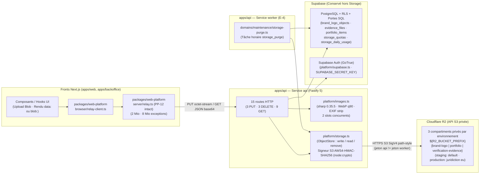
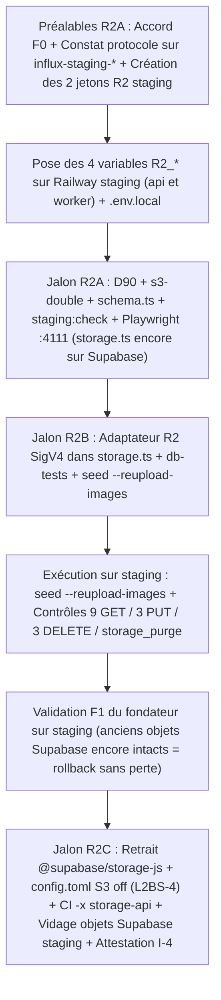

# 23 — Lot 3ter : migration du stockage des images vers Cloudflare R2 (code R2)

> **Date :** 2026-11-26 · **Rédigé par :** `chef-de-projet`, sur revue croisée de `architecte`,
> `expert-database`, `expert-cybersecurite`, `expert-conformite-rgpd`, `dev-react-node`, `testeur` et
> `integrateur` · **Statut : à valider par le fondateur (décision `D90` ouverte, §9).** **Aucun code ni
> déploiement n'est permis avant l'accord de démarrage `F0`.**
>
> **Place dans la feuille de route :** lot technique intercalaire (**Lot 3ter**, code `R2`, jalons `R2A`
> à `R2C`, découpage dans `jalons/lot3ter-plan.md`), après le Lot 3 (clos le 2026-11-21) et **avant le
> Lot 4** (`introduction-documents`), réalisable sans collision avec le Lot 3bis (`22-refonte-ux-ui.md`,
> code `RU`, aucun fichier d'écran commun).
>
> **Skills appliquées :** `feature-spec`, `env-secrets`, `supabase-schema`, `security-rgpd-audit`,
> `test-strategy`, `railway-deploy`, `lot-decoupe`, `jalon-prepare`.
>
> **Documents qui contraignent celui-ci :** `CLAUDE.md`, `02-architecture-3-espaces.md` (§9.3, §12.3,
> §12.4, §19, §20), `03-matrice-des-droits-et-rls.md` (P7, P10, §6.4 à §6.8, I-4),
> `04-modele-de-donnees-mvp.md` (§5.2, §5.3, §5.11, §9.1, §9.2), `06-criteres-profil-marque.md` (RG15,
> RG18), `07-criteres-profil-createur-reseaux-audience.md` (RG77 à RG84, RG111),
> `08-verification-et-badge.md` (RG34, RG35, RG83 à RG86), `10-recherche-createurs-anonymisee.md` (RG50,
> RG84), `18-plan-de-test-mvp.md` (T9, T10, T11, T14, T17), `21-plan-de-developpement.md` (§0, §2.2,
> §2.4, §5.8, §8), `decisions-detail.md` (D25, D60, D64, D70, D71, D80, D82, D87 à D89), runbooks
> `staging.md` et `production.md`, audit préalable `../audit-stockage-images-cloudflare.md` (2026-11-26).

---

## 1. Objectif, contexte et périmètre

### 1.1 Besoin et objectif de la migration

Remplacer **Supabase Storage** par **Cloudflare R2** (stockage objet privé compatible S3) comme seul
moteur physique de conservation des images téléversées par les utilisateurs d'INFLUX, tout en conservant
**Supabase** pour l'intégralité du reste (PostgreSQL managé, rôles et politiques RLS, migrations SQL,
Supabase Auth / GoTrue) et sans modifier aucun contrat HTTP, aucun écran ni aucune règle métier des
Lots 0 à 3bis.

Quatre problèmes concrets motivent ce lot avant l'ouverture aux vrais utilisateurs et avant le Lot 4 :

1. **Plafond économique et volumétrique de Supabase Storage :** le palier gratuit Supabase plafonne à
   1 Go de stockage et 2 Go de bande passante, rapidement saturés par des portfolios créateurs et pièces
   d'audience jusqu'à 8 Mio par fichier (`D82`). Cloudflare R2 offre un palier gratuit de **10 Go/mois**,
   1 million d'opérations d'écriture (Classe A), 10 millions d'opérations de lecture (Classe B) et
   **0 \$ de frais de sortie R2 → `apps/api`**.
2. **Séparation des secrets d'authentification et de stockage :** aujourd'hui, `SUPABASE_SECRET_KEY`
   ouvre simultanément l'API d'administration GoTrue et l'ensemble du stockage d'objets (`03` §6.7 pt 4).
   Migrer le binaire vers R2 dote le stockage de ses propres identifiants S3 révocables séparément par
   service (`api` vs `worker`) et par environnement (`staging` vs `production`), réduisant `SUPABASE_*`
   au seul GoTrue.
3. **Résidence européenne garantie et suppression du reliquat `L2BS-4` :** R2 fournit une juridiction
   stricte **`eu`** sur les compartiments de production (`D25`), et permet de désactiver le protocole S3
   de Supabase Storage (`[storage.s3_protocol] enabled = false`), soldant le ticket de sécurité
   **`L2BS-4`** (`21` §8 l. 171).
4. **Allègement de la pile locale et de la CI :** une doublure HTTP S3 locale légère en mémoire dans
   `@influx/test-kit` remplace les appels réseau vers Kong + `storage-api` (~1,3 Go d'image Docker sur
   5 machines virtuelles par push CI), accélérant notamment l'éclat 2 des tests de base (`6:24` pour un
   plafond dur de `7:30`).

### 1.2 Périmètre fonctionnel et technique inclus

L'analyse exhaustive du dépôt confirme que **100 % des objets stockés dans Supabase Storage sont des
images utilisateur ré-encodées côté serveur en WebP sans métadonnées** (`sharp` 0.35.5 dans
`apps/api/src/platform/images.ts`), réparties dans **3 compartiments privés** :

| Compartiment logique | Domaine métier | Qui dépose (`PUT`) | Qui lit (`GET`) | Qui retire (`DELETE` / purge) | Plafond reçu (passe-plat) | Plafond stocké (WebP) | Dimensions | Quota / jour UTC / compte |
|---|---|---|---|---|---|---|---|---|
| `brand-logo` | Logo du profil marque (`06` RG15, RG18) | Annonceur propriétaire | Annonceur propriétaire (+ `pendingLogo`), créateur publié (campagne ouverte), agent/admin en `aal2` (file 1, hors conflit RG36, journalisé) | Annonceur (`removeAtBest` ou révision sur profil publié), effacement RGPD, tâche E-4 `storage_purge` | 2 Mio (`2 097 152` o) | 1 Mio (`1 048 576` o) | Carré `512 × 512` (grand côté ≥ 256 px, `contain`, alpha) | 10 dépôts / 20 Mio |
| `verification-evidence` | Pièces de preuve d'audience créateur (`08` RG34, RG35, RG84) | Créateur propriétaire (demande en `draft`, max 6 pièces) | **Backoffice uniquement** : agent/admin en `aal2` tenant le verrou (file 4 et contestations file 5), journalisé (`verification.evidence_viewed`) | Créateur sur `draft` (`removeAtBest`), doublon SHA-256 remplacé, refus `evidence_too_wide`, annulation, rétention 45 j (`decided_at`), effacement RGPD, `storage_purge` | 8 Mio (`8 388 608` o) | 8 Mio (`8 388 608` o) | Sans redimensionnement (320 à 16 383 px, ≤ `4 096²` px) | 18 dépôts / 64 Mio |
| `portfolio` | Visuels du portfolio créateur (`07` RG77 à RG84, `10` RG50) | Créateur propriétaire (max 8 places, ou `?replaces=<uuid>`) | Créateur propriétaire (+ aperçu), marque (recherche/profil anonyme, visuels `approved` seuls), agent/admin en `aal2` (files 2 et 3, journalisé) | Créateur → état `withdrawn` conservé 30 j (`portfolio_retention_days`), abandon d'upload > 15 min, perte du rôle créateur, effacement RGPD, `storage_purge` | 8 Mio (`8 388 608` o) | 8 Mio (`8 388 608` o) | Sans redimensionnement (320 à 16 383 px, ≤ `4 096²` px) | 16 dépôts / 64 Mio |

Sont inclus dans le Lot 3ter :
- l'adaptateur unique `apps/api/src/platform/storage.ts` et son injection dans `server.ts` et `worker.ts` ;
- la validation de configuration `apps/api/src/config/schema.ts` (`api` et `worker`), `apps/api/.env.example`, et le contrôle d'exploitation `staging:check` (`staging.md`, `staging-check-rules.ts`) ;
- la doublure HTTP S3 locale `packages/test-kit/src/s3-double.ts`, branchée sur les tests unitaires, les 5 `db-tests` HTTP et les 4 serveurs Playwright E2E (`playwright.config.ts`, `servers.ts`) ;
- le script opérateur `apps/api/scripts/seed-staging-fake-profiles.ts` (écriture R2, gardes anti-production et mode idempotent `--reupload-images`) ;
- le retrait de `@supabase/storage-js`, la mise à jour d'ESLint et des gardes statiques (`FORBIDDEN_PACKAGES`, `BROWSER_FORBIDDEN_NAMES`, T9.2, T9.6, T9.7), la désactivation S3 Supabase (`L2BS-4`), l'ajustement CI (`.github/workflows/ci.yml`) et le vidage final des objets Supabase Storage de `staging`.

### 1.3 Éléments inexistants ou explicitement hors périmètre

- **Fonctionnalités inexistantes dans le produit (vérifiées dans le code, non concernées) :** il n'existe ni photo de profil/avatar créateur distincte du portfolio (`RU-07` / `D88` : avatar uni `surface-active`), ni image d'illustration propre à une campagne (seul le logo actif de la marque est affiché sur une campagne ouverte), ni pièce jointe de messagerie implémentée à ce stade.
- **Compartiments futurs hors Lot 3ter :** `introduction-documents` (`04` §5.11, `12` RG68 : Lot 4, sous arbitrage `D30`) utilisera directement l'adaptateur R2 livré par le Lot 3ter s'il est ouvert ; `legal-documents` (`04` §5.11) est caduc en stockage objet car les CGU/politiques sont versionnées et servies depuis PostgreSQL (`identity.terms_versions`, `publish-terms.ts`).
- **Hors périmètre strict :**
  - images statiques de la vitrine (`apps/web/src/content/images/*.jpg`, `landing-images.ts`) et captures d'audit (`docs/audit-ux-ui/captures/*.jpg`) ;
  - pipeline `sharp` (`apps/api/src/platform/images.ts`), limites d'octets/pixels et quotas SQL ;
  - mode de distribution des images aux navigateurs : le relais serveur `apps/api` en JSON `base64` (`D80`, `D82`) est **intégralement conservé** (aucune URL présignée R2, aucun flux d'octets hors schéma JSON, aucune modification des CSP ni des contrats `@influx/contracts`) ;
  - composants React, hooks et styles de `apps/web` et `apps/backoffice` (refondus séparément par le Lot 3bis `22-refonte-ux-ui.md`) ;
  - PostgreSQL, Drizzle, politiques RLS métiers, Supabase Auth / GoTrue (`src/platform/supabase.ts`), file `outbox_events`, Brevo et Apollo.io.

---

## 2. Confrontation de l'audit Gemini au code réel

Un seul rapport d'audit existe dans l'espace de travail : `docs/audit-stockage-images-cloudflare.md`
(daté du `2026-11-26`, aucune version divergente). Sa confrontation systématique au code source, aux
migrations SQL, aux suites de tests et à la documentation officielle Cloudflare R2 établit le bilan
suivant.

### 2.1 Conclusions de l'audit confirmées par le code

1. **Isolation parfaite de l'adaptateur (`apps/api/src/platform/storage.ts:1-222`) :** c'est bien le
   **seul** fichier du monorepo important `@supabase/storage-js` (`2.117.2`), verrouillé par
   `apps/api/eslint.config.mjs:37-41, 260-262` et `apps/api/tests/supabase-guards.test.ts:75-100`.
2. **Contrat minimal `ObjectStore` (`storage.ts:74-89`) :** l'intégralité de `apps/api` (`server.ts:601`,
   `worker.ts:409`, les 15 routes HTTP et `domains/maintenance/storage-purge.ts:29-78`) ne consomme que
   trois méthodes : `write(bucket, key, bytes, "image/webp")`, `read(bucket, key)` et `remove(bucket, key)`.
3. **Découplage total vis-à-vis de GoTrue et des fronts :** `apps/api/src/platform/supabase.ts:1-744`
   n'importe que `@supabase/auth-js` et expose déjà `boundedFetch()` (`l. 222-238`). `packages/web-platform/src/server/relay.ts:36-67`
   et les hooks de `apps/web` et `apps/backoffice` ne connaissent ni hôte ni clé de stockage.
4. **Indépendance du schéma SQL métier :** `object_key` est généré en base dans les 3 tables
   (`0204`, `0221`, `0242`), `profiles.storage_quotas` n'a aucune clé étrangère vers le schéma `storage`
   (`0204:55-56`, EC-L2B-08-5), et aucune porte SQL métier ou de purge (`0205`, `0223`, `0242`) ne lit
   `storage.objects` ni `storage.buckets` à l'exécution.
5. **Infrastructure R2 déjà créée sur le compte Cloudflare :** les 6 compartiments privés
   `influx-staging-{brand-logo,portfolio,verification-evidence}` (juridiction `default`) et
   `influx-production-{brand-logo,portfolio,verification-evidence}` (juridiction `eu`) existent avec
   accès public `r2.dev` désactivé.

### 2.2 Hypothèses de l'audit levées par la documentation officielle Cloudflare R2

| Point laissé incertain dans l'audit | Vérification officielle Cloudflare R2 (nov. 2026) | Décision retenue |
|---|---|---|
| Support de `If-None-Match: *` sur `PutObject` (§4.3 l. 300) | **Confirmé et atomique** (`/r2/api/s3/conditional-operations/`, `/r2/reference/consistency/`) : R2 sérialise les `PutObject` concurrents sur une même clé et rejette toute réécriture par `412 PreconditionFailed`. | En-tête `If-None-Match: "*"` obligatoire sur tout `PUT` (dans `storage.ts` et dans `s3-double.ts`), doublé d'un constat réel sur `influx-staging-*` en préalable `R2A`. |
| Région SigV4 sur l'endpoint juridictionnel `*.eu.r2.cloudflarestorage.com` (§4.2–4.3) | **Confirmé** (`/r2/reference/data-location/`) : `region` vaut toujours `"auto"`, y compris sur `<account_id>.eu.r2.cloudflarestorage.com` ; un endpoint `eu` refuse tout accès hors `eu`. | Constante `R2_REGION = "auto"` dans le signeur SigV4 pour tous les environnements. |
| Existence d'un jeton R2 « suppression seule » pour `worker` (§4.2 l. 290) | **Infirmé** (`/r2/api/tokens/`) : les jetons R2 statiques n'offrent que 4 portées (`object-read-only`, `object-read-write`, `admin-read-only`, `admin-read-write`) ; `actions: ["DeleteObject"]` n'existe que sur des *Temporary Credentials* mono-bucket éphémères. | Deux jetons distincts (`api` et `worker`) en `object-read-write` bornés aux **3 compartiments de leur environnement** ; restriction « suppression seule » du `worker` garantie par le code et une garde statique. |
| Risque de rétention cachée par versioning d'objet R2 (§8.1 l. 412) | **Confirmé sans versioning** : Cloudflare R2 n'implémente pas le versioning d'objet S3 ; `DeleteObject` supprime immédiatement et définitivement l'objet. | Effacement RGPD immédiatement définitif ; règle `AbortIncompleteMultipartUpload = 1 jour` ajoutée par hygiène sur les 6 compartiments. |

### 2.3 Corrections factuelles, oublis bloquants et risques non vus par l'audit

| # | Gravité | Conclusion ou omission de l'audit Gemini | Réalité constatée dans le dépôt et correction impérative |
|---|---|---|---|
| **C1** | **Bloquant (`Migrate staging` / `production`)** | §7.4 pt 2 (`l. 399`) propose une nouvelle migration SQL supprimant les lignes de `storage.buckets`. | **Erreur SQL bloquante :** Supabase pose le trigger `protect_buckets_delete` (`0204:63`) qui bloque tout `DELETE FROM storage.buckets` en SQL, et 4 suites `db-tests` (`profiles-brand-logo`, `profiles-portfolio`, `verification-evidence`, `t9-evidence-unreachable`) + leurs planchers `case-floors.ts` assertent ces 3 lignes `public = false`. **Correction :** aucune migration SQL sur `storage.buckets` ; conserver les 3 lignes `public = false` et les politiques `influx_no_member_access` (`03` P10.6), vider uniquement les objets via l'API Storage sur `staging`, et désactiver `[storage.s3_protocol]` dans `supabase/config.toml` (solde **`L2BS-4`**). |
| **C2** | **Bloquant (CI E2E 100 % rouge)** | §3.5.C (`l. 246-263`) omet totalement Playwright E2E, les chargeurs `recette` et `E2E_VISUAL=app`. | `apps/web/playwright.config.ts:134-169` démarre `e2e/start-api.ts:11-23` sans `.env.local` (`16` RG148). Sans `s3-double` lancé en `webServer` (`S3_DOUBLE_PORT = 4111`) et `R2_*` injectées dans `start-api.ts`, `loadApiConfig()` plante au boot (44/44 specs E2E rouges), et 8 specs + `recette-loaders.spec.ts` + `E2E_VISUAL=app` (Lot 3bis) lisent/écrivent réellement des WebP. |
| **C3** | **Critique (CI `db` et `e2e`)** | §3.5.B et §7.4 supposent acquis l'ajout immédiat de `storage-api` à `supabase start -x`. | `ci.yml:249, 389` exécute `supabase db reset --no-seed`, qui rejoue les migrations immuables `0204`, `0213`, `0223` et `0242` (`INSERT INTO storage.buckets (..., file_size_limit, allowed_mime_types)`). Si l'image `supabase/postgres` seule ne porte pas ces colonnes sans le démarrage initial de `storage-api`, `db reset` échoue. **Correction :** test local obligatoire avant de modifier `ci.yml`, avec repli documenté. |
| **C4** | **Majeur (Données `staging`)** | §7.1 pt 4 (`l. 367-368`) propose `seed --purge` supprimant en base les 150 comptes `seed-fake-profiles`. | `audit.audit_events.actor_account_id → identity.accounts(id) ON DELETE RESTRICT` (`04:6134`) et les FK sans cascade bloquent le `DELETE` physique, et `staging` conserve des données de recette Lot 3 (`L3F-RECETTE`, `21:235`) pouvant référencer ces comptes. **Correction :** écarter `--purge` au profit d'une option idempotente **`--reupload-images`** qui régénère et ré-envoie dans R2 les WebP des 150 comptes existants aux `object_key` déjà enregistrés en base. |
| **C5** | **Bloquant (CI `check` + crash Railway)** | Omission de `staging:check` (`staging-check.test.ts`), de `T11.4` (`database-variables.test.ts`), de `T11.1` (`artifacts.ts`), de la symétrie `D70` (`T17`) et de l'ordre Railway. | 1) `schema.ts`, `.env.example` et `staging.md` (`<!-- staging-check:begin/end -->`) doivent être mis à jour **dans le même commit**. 2) `schema.ts` ne doit contenir **aucun** `INFLUX_ENV === "production"` (`02` §12.4, `T17`). 3) Sur `worker`, `R2_*` doit être tout-ou-rien en `development` et exigé sous `isDeployedEnvironment`. 4) Sur Railway `staging`, `R2_*` doit être posé **avant** le push sur `main` (« Wait for CI »). |
| **C6** | **Important (Concurrence de chantier)** | Non-analyse de la coexistence avec le Lot 3bis (`RUB` en cours sur `main`). | Le jalon `RUB` modifie actuellement `apps/web/src/components/member/ui/*`. Le Lot 3ter ne touche **aucun** fichier de `apps/web/src/`, `apps/backoffice/src/`, `packages/ui/`, `packages/contracts/` ni `packages/web-platform/` : les deux lots sont techniquement orthogonaux. |

---

## 3. Architecture cible et arbitrages techniques

### 3.1 Topologie cible des flux d'images

### 3.2 Répartition des rôles après migration

| Système / Couche | Rôle exact après migration | Ce qu'il ne fait jamais |
|---|---|---|
| **Cloudflare R2** | Stockage physique privé des octets WebP ré-encodés, adressés par `${R2_BUCKET_PREFIX}${bucket}/${object_key}`, avec anti-écrasement atomique (`If-None-Match: "*"`) et résidence `eu` en production. | Jamais d'accès public (`r2.dev` ou domaine personnalisé), jamais de transformation d'image, jamais d'appel direct depuis un navigateur, jamais de versioning d'objet. |
| **Supabase** | Source de vérité relationnelle PostgreSQL (métadonnées d'objets, `object_key` généré, états, quotas UTC, verrous de files, registre d'audit chaîné `audit.*`, effacement RGPD) + authentification GoTrue (`SUPABASE_URL`, `SUPABASE_SECRET_KEY`). | Ne stocke plus aucun objet binaire ; `storage-api` n'est plus sollicité par `apps/api` ni par `worker`, et `[storage.s3_protocol]` est désactivé. |
| **`apps/api` (`api`)** | Vérifie droits et quotas en base, ré-encode en WebP sans métadonnée (`images.ts`), signe et exécute `PUT` / `GET` / `DELETE` vers R2 (`storage.ts` avec le jeton `api`), relaie les lectures en JSON `base64`. | N'émet aucune URL présignée ou publique, n'expose aucun en-tête/hôte R2, ne liste jamais un compartiment (`ListObjectsV2` absent). |
| **`apps/api` (`worker`)** | Exécute la tâche horaire E-4 `storage_purge` en appelant uniquement `ObjectStore.remove()` avec son propre jeton R2 (`worker`), puis valide la purge en base (`ops.complete_storage_purges`). | N'écrit ni ne lit aucun objet dans R2 ; conserve `SUPABASE_*` pour la seule purge des utilisateurs GoTrue orphelins (`auth_orphan_purge`) et E-5. |
| **Passe-plat & Fronts** | `packages/web-platform`, `@influx/contracts`, `apps/web` et `apps/backoffice` fonctionnent **à l'identique** (dépôt `Blob` `application/octet-stream`, affichage `data:image/webp;base64,…` sur `web` et `blob:` sur `backoffice`). | Zéro variable `R2_*`, zéro dépendance S3, zéro ouverture des directives CSP `img-src` ou `connect-src`. |

### 3.3 Arbitrages techniques (`architecte`)

#### Arbitrage A1 — Client S3 dans `src/platform/storage.ts` : `node:crypto` SigV4 natif vs `@aws-sdk/client-s3`

- **Option 1 (retenue) — Signeur AWS Signature V4 interne (`node:crypto` + `boundedFetch` de Node 24) :**
  zéro dépendance externe ajoutée (et retrait de `@supabase/storage-js`, ramenant `apps/api` de 11 à 10
  dépendances directes). Les 3 requêtes S3 path-style (`PUT`, `GET`, `DELETE`) portent sur des clés
  strictement ASCII déjà filtrées par `isObjectKey()`, sans query string. Le signeur (~70 lignes) et
  l'adaptateur complet (~200 lignes : flux de lecture borné, extraction XML `<Code>` bornée, timeouts
  `10 000 ms`) sont prouvés sur les vecteurs officiels AWS SigV4, contre `s3-double` (qui recalcule et
  vérifie la signature) et contre R2 `staging`.
- **Option 2 (écartée) — `@aws-sdk/client-s3` :** introduit ~85 paquets transitifs `@smithy/*` (~15 Mo),
  élargit la surface d'audit CVE hebdomadaire (`T12` / `PLS-2`), impose des réglages spécifiques contre
  les incompatibilités `aws-chunked` checksums avec R2, et contredit la règle `architecte` de sobriété
  des dépendances pour seulement 3 verbes HTTP plats.
- **Réversibilité :** totale ; toute l'implémentation est confinée derrière `createObjectStore()` dans un
  unique fichier (`apps/api/src/platform/storage.ts`).

#### Arbitrage A2 — Nommage des compartiments R2 : `R2_BUCKET_PREFIX` unique vs 3 variables par service

- **Option 1 (retenue) — Variable unique `R2_BUCKET_PREFIX` + noms logiques `STORAGE_BUCKETS` :** le nom
  physique du compartiment R2 est calculé par `${prefix}${bucket}` (ex. `influx-staging-` + `portfolio` →
  `influx-staging-portfolio`), ce qui correspond exactement aux 6 compartiments déjà créés sur Cloudflare.
  Avantages décisifs : **impossibilité structurelle de faire pointer deux compartiments de sensibilité
  différente (`verification-evidence` et `portfolio`) vers le même bucket R2** par erreur de copie (`03`
  P10.2, `C(13)`), 4 variables au lieu de 6 sur `api` et `worker`, et extensibilité sans nouvelle variable
  Railway si `introduction-documents` est ouvert au Lot 4.
- **Option 2 (écartée) — 3 variables `R2_BUCKET_*` :** alourdit la liste fermée de `staging.md` de 4
  entrées supplémentaires et oblige à coder des contrôles d'inégalité deux à deux pour éviter une fusion
  accidentelle de compartiments.

#### Arbitrage A3 — Validation de `R2_ENDPOINT` et `R2_BUCKET_PREFIX` sous D70 (`staging` = `production`) et D25 (`eu`)

Dans `02` §12.4 et `18` `T17`, `schema.ts` ne doit contenir **aucun branchement `INFLUX_ENV === "production"`**
(`staging` et `production` partagent le prédicat unique `isDeployedEnvironment`). La garantie de résidence
`eu` en production est donc assurée par **trois verrous complémentaires** sans exception à D70 :

1. **Au démarrage (`apps/api/src/config/schema.ts`) :**
   - En `development` : `R2_ENDPOINT` doit être une origine `http://` sur `LOOPBACK_HOSTS` (`127.0.0.1`,
     `localhost`, `[::1]`), refusant tout hôte `*.r2.cloudflarestorage.com` (`16` RG148 : aucun test
     n'atteint le cloud) ; `R2_BUCKET_PREFIX` vaut `""` par défaut ou `^[a-z0-9][a-z0-9-]{0,30}-$`. Sur
     `worker`, les variables R2 suivent la règle du **tout-ou-rien** en `development` (absentes →
     `config.r2 = null`, comme `SUPABASE_*` aujourd'hui).
   - Sous `isDeployedEnvironment` (`staging` et `production`, règle identique) : les 4 variables sont
     **exigées** sur `api` et `worker` ; `R2_ENDPOINT` doit vérifier
     `^https://[0-9a-f]{32}\.(?:eu\.)?r2\.cloudflarestorage\.com$` (origine `https://` stricte sans chemin,
     query ni identifiants) ; `R2_BUCKET_PREFIX` doit vérifier `^influx-(?:staging|production)-$`.
2. **En `staging` (`staging:check` + `script-guards.ts`, autorisés à tester `staging` hors `schema.ts`) :**
   `staging:check` vérifie que `api` et `worker` portent `R2_BUCKET_PREFIX=influx-staging-`, un endpoint
   sans `.eu.`, et deux `R2_ACCESS_KEY_ID` distincts entre `api` et `worker` ; `seed-staging-fake-profiles.ts`
   refuse tout endpoint `.eu.` et tout préfixe autre que `influx-staging-`.
3. **En `production` (`runbooks/production.md` + script pré-vol `J9S-1`) :** impose l'endpoint
   `https://<account_id>.eu.r2.cloudflarestorage.com`, `R2_BUCKET_PREFIX=influx-production-`, deux jetons
   émis sur la juridiction `eu` et l'absence totale de valeur héritée de `staging`.

#### Arbitrage A4 — Maintien du mode de distribution relais JSON `base64` (`D80`, `D82`)

La distribution reste **inchangée** : `apps/api` lit les octets dans R2 et répond en JSON validé par Zod
(`contentType`, `width`, `height`, `byteSize`, `data` en `base64`). Introduire des URLs présignées R2 ou
des routes binaires dans le même lot obligerait à ouvrir la CSP de `apps/web`, modifier les contrats et
affaiblir `T9.2`/`T9.6`. Toute optimisation ultérieure (pour `brand-logo` et `portfolio` `approved`
uniquement, jamais `verification-evidence`) relèvera d'une décision séparée si les métriques Railway en
démontrent le besoin.

---

## 4. Données, contrat S3 et compatibilité PostgreSQL

### 4.1 Structure physique des objets dans Cloudflare R2

| Propriété S3 / R2 | Spécification exacte |
|---|---|
| **Mode d'adressage URL** | **Path-style obligatoire** : `${R2_ENDPOINT}/${R2_BUCKET_PREFIX}${bucket}/${objectKey}` (identique contre Cloudflare R2 et contre `http://127.0.0.1:<port>` de `s3-double`, sans DNS wildcard). |
| **Compartiments physiques** | `staging` : `influx-staging-brand-logo`, `influx-staging-portfolio`, `influx-staging-verification-evidence` (juridiction `default`). `production` : `influx-production-brand-logo`, `influx-production-portfolio`, `influx-production-verification-evidence` (juridiction `eu`). |
| **Clés d'objet (`objectKey`)** | Générées exclusivement par PostgreSQL (`GENERATED ALWAYS AS ... STORED`) et revalidées par `isObjectKey(bucket, key)` avant tout appel réseau : - `brand-logo` : `^<uuid_account>/<uuid_logo>\.webp$` - `portfolio` : `^<uuid_account>/<uuid_item>\.webp$` - `verification-evidence` : `^<uuid_account>/<uuid_request>/<uuid_evidence>\.webp$` |
| **Format & en-têtes d'objet** | Octets WebP sRGB ré-encodés sans aucune métadonnée (`sharp`), `Content-Type: image/webp`, `Content-Length: <octets>`, `If-None-Match: "*"`, `x-amz-content-sha256: <sha256 hex réel>`. **Aucune métadonnée `x-amz-meta-*`** (toutes les métadonnées métier vivent en PostgreSQL). |
| **Cycle de vie R2** | Aucune expiration automatique d'objets validés sur R2 (PostgreSQL gouverne seul la rétention via `ops.claim_storage_purges`, `04` §5.11 règle 4). Seule règle R2 autorisée : `AbortIncompleteMultipartUpload` à `1 jour` (hygiène). |

### 4.2 Schéma PostgreSQL, migrations et défense en profondeur `storage.*`

1. **Zéro migration destructive ni modification de tables métiers :** les tables
   `profiles.brand_logo_objects`, `verification.evidence_files`, `profiles.portfolio_items`,
   `profiles.storage_quotas`, `profiles.storage_daily_usage`, toutes les portes `SECURITY DEFINER` des
   schémas `profiles`, `verification`, `search`, `privacy` et `ops`, ainsi que
   `packages/test-kit/src/rights/expected-rights.ts`, restent **strictement inchangés**.
2. **Immutabilité des migrations appliquées (`check-migrations.ts`, EC-37) :** les migrations `0204`,
   `0205`, `0213`, `0223`, `0242` et suivantes ne sont jamais modifiées.
3. **Conservation volontaire des gardes SQL sur `storage.buckets` et `storage.objects` (`03` P10.6) :**
   les 3 lignes `public = false` dans `storage.buckets` et les politiques restrictives
   `influx_no_member_access` (`FOR ALL TO anon, authenticated USING (false) WITH CHECK (false)`) sont
   **conservées en base**. Cela évite l'échec du trigger interne Supabase `protect_buckets_delete`,
   maintient la défense en profondeur si `storage-api` reste actif côté Supabase hébergé, et préserve
   100 % des assertions SQL des tests de Catégorie B (`profiles-brand-logo.test.ts`,
   `profiles-portfolio.test.ts`, `verification-evidence.test.ts`, `t9-evidence-unreachable.test.ts`,
   `creator-profile-door.test.ts`) sans abaisser aucun plancher `case-floors.ts`.

### 4.3 Stratégie vis-à-vis des données existantes

Tous les environnements ne contiennent aujourd'hui que des **données synthétiques ou de testeurs
internes** (`production` n'est pas ouverte au public, `21` §0). Conformément à l'arbitrage de simplicité :

- **Aucune copie d'objets de Supabase Storage vers Cloudflare R2 n'est développée** pour le Lot 3ter.
- **Profils synthétiques du seed (`staging`) :** les 100 créateurs et 50 marques portant
  `signup_utm_source = 'seed-fake-profiles'` sont conservés en base (préservant les clés étrangères, le
  registre d'audit `ON DELETE RESTRICT` et les données de recette `L3F-RECETTE`). Le script
  `seed-staging-fake-profiles.ts` reçoit une option **`--reupload-images`** qui relit leurs `object_key`
  actifs/approuvés en base, régénère de façon déterministe les WebP depuis le pool photo, met à jour les
  dimensions/tailles/checksums si nécessaire et écrit chaque WebP dans R2 (`If-None-Match: "*"` : un code
  `412 PreconditionFailed` est compté en `skipped`, rendant la commande 100 % idempotente et rejouable).
- **Comptes de démonstration / dépôts manuels antérieurs sur `staging` :** leurs lignes SQL éventuelles
  pointeront vers des clés absentes de R2. Les routes de lecture gèrent déjà nativement l'objet absent
  (`read.value === null`, voir §6.6) sans jamais casser un écran ; un testeur redépose simplement un logo
  ou un visuel si besoin.

---

## 5. Sécurité, permissions et conformité RGPD

### 5.1 Gestion des identifiants et secrets R2 (skill `env-secrets`)

| Variable | Services Railway | `development` (tests, CI, pile locale) | `staging` et `production` (`isDeployedEnvironment`) |
|---|---|---|---|
| `R2_ENDPOINT` | `api`, `worker` | Origine `http://` loopback uniquement (`127.0.0.1`, `localhost`, `[::1]`). Requis sur `api`, tout-ou-rien sur `worker`. Tout hôte cloud refusé (`RG148`). | **Exigée.** `https://<account_id>.(eu.)r2.cloudflarestorage.com` sans chemin, query ni credentials (`eu.` obligatoire en `production` via runbook/pré-vol). |
| `R2_ACCESS_KEY_ID` | `api`, `worker` | Chaîne non vide sans `CHANGE_ME`. Requis sur `api`, tout-ou-rien sur `worker`. | **Exigée.** Identifiant du jeton R2 **propre au service** (`influx-<env>-api` ≠ `influx-<env>-worker`). |
| `R2_SECRET_ACCESS_KEY` | `api`, `worker` | Secret ≥ 32 octets sans `CHANGE_ME`, différent de `R2_ACCESS_KEY_ID` et de tout autre secret du processus (`schema.ts:988`). | **Exigée.** Secret S3 SHA-256 du jeton R2 propre au service, jamais sur `web` ni `backoffice`. |
| `R2_BUCKET_PREFIX` | `api`, `worker` | Défaut `""` ou `^[a-z0-9][a-z0-9-]{0,30}-$` (ex. `e2e-`, `local-`). | **Exigée.** `^influx-(?:staging|production)-$` (`influx-staging-` sur `staging`, `influx-production-` en `production`). |

Règles impératives :
1. **Moindre privilège des jetons Cloudflare R2 :** chaque jeton est créé avec la permission
   **`Object Read & Write`** restreinte aux **3 seuls compartiments de son environnement** (jamais
   `Admin Read & Write`, jamais « All buckets »). Les jetons de `production` sont créés sous la
   juridiction `eu` et posés directement dans Railway `production` par le fondateur (`16` RG115 : jamais
   dans `.env.local`).
2. **Cloisonnement navigateur (`T11.1`, `CI-1`, `CI-2`) :** le préfixe `"R2_"` est ajouté à
   `BROWSER_FORBIDDEN_NAMES` dans `packages/test-kit/src/artifacts.ts` ; toute présence dans `.next/static`
   de `apps/web` ou `apps/backoffice` fait échouer `pnpm check`.
3. **Rotation (`rotation-et-fuite.md`) :** les clés R2 n'ayant aucun effet d'envoi externe vers un tiers,
   elles suivent une rotation sans coupure dérivée de la **Procédure A/B sortante** : création d'un
   nouveau jeton sur les 3 mêmes compartiments → mise à jour de `R2_ACCESS_KEY_ID` et
   `R2_SECRET_ACCESS_KEY` du service (`api` ou `worker`) → redéploiement et constat de lecture/écriture →
   **révocation immédiate de l'ancien jeton** dans le tableau de bord Cloudflare.

### 5.2 Sécurité du protocole S3, des flux mémoire et des journaux (`D60`)

1. **Validation de clé avant signature (`T9.3`, `T9.9`, anti-SSRF) :** `write`, `read` et `remove`
   appellent `isObjectKey(bucket, key)` **avant** toute construction d'URL ou signature. Toute clé hors
   motif `^<uuid>/...\.webp$` renvoie `{ ok: false, reason: "rejected", status: null, errorCode: "invalid_key" }`
   sans émettre de requête réseau. L'hôte est exclusivement l'origine validée de `config.r2.endpoint`.
2. **Signature AWS SigV4 stricte :** algorithme `AWS4-HMAC-SHA256`, région `"auto"`, service `"s3"`,
   en-têtes signés triés (`content-type;host;if-none-match;x-amz-content-sha256;x-amz-date` sur `PUT`,
   `host;x-amz-content-sha256;x-amz-date` sur `GET`/`DELETE`). Sur `PUT`, `x-amz-content-sha256` est le
   SHA-256 hexadécimal réel du `Uint8Array` WebP (`UNSIGNED-PAYLOAD` est interdit pour garantir
   l'intégrité de bout en bout).
3. **Protection mémoire à la lecture (`read()`) :** avant de lire le corps HTTP `200`, si l'en-tête
   `Content-Length` est présent et `> STORAGE_READ_MAX_BYTES[bucket]` (`1 Mio` pour `brand-logo`, `8 Mio`
   pour `verification-evidence` et `portfolio`), le flux est annulé immédiatement (`body.cancel()`) et
   `read()` renvoie `MALFORMED_ANSWER` (`unavailable`). Pendant la lecture en flux (`getReader()`), le
   cumul d'octets est vérifié à chaque morceau : dès que le cumul dépasse `STORAGE_READ_MAX_BYTES[bucket]`
   (même si `Content-Length` est absent ou mensonger), le lecteur annule immédiatement le flux sans
   allouer le reste en mémoire.
4. **Réduction stricte des erreurs S3 XML et étanchéité des journaux (`D60`, `T13`) :** en cas de statut
   HTTP ≥ 400, `storage.ts` lit au plus `8 192` octets du corps d'erreur et extrait uniquement la balise
   `<Code>([A-Za-z0-9_]{1,64})</Code>` (ex. `NoSuchKey`, `PreconditionFailed`, `AccessDenied`,
   `SignatureDoesNotMatch`, `InternalError`). Ni `<Message>`, ni `<Key>`, ni `<RequestId>`, ni l'URL, ni
   `Authorization`, ni `R2_ACCESS_KEY_ID`/`R2_SECRET_ACCESS_KEY` ne sont jamais retournés ni passés à
   `pino` ou `ops`.
5. **Absence totale d'URL exposée (`T9.2`, `T9.6`, `T9.7`) :** aucune méthode de présignature S3
   (`X-Amz-Signature` en query string, `X-Amz-Expires`) ni de listage (`ListObjectsV2`) n'existe dans
   `apps/api/src/`. Les tests `T9.2` et `T9.6` vérifient qu'aucune réponse API ne contient `supabase`,
   `r2.cloudflarestorage.com`, `r2.dev` ou `x-amz-`.

### 5.3 Conformité RGPD

- **Sous-traitance Cloudflare :** les captures d'audience (`verification-evidence`, contenant
  potentiellement des données de tiers, `08` §I), les visuels créateurs et les logos rattachés à un
  compte constituent des données à caractère personnel. Avant l'ouverture de `production` (`21` §5.8),
  INFLUX doit avoir accepté le DPA Cloudflare, inscrit **Cloudflare, Inc. (Cloudflare R2, juridiction UE)**
  au registre des traitements et mis à jour la politique de confidentialité sous validation du juriste
  (`D29`, `RU-30`).
- **Résidence des données :** `production` utilise exclusivement la juridiction **`eu`** (`D25`).
  `staging` utilise la juridiction `default` sous la condition stricte du **Verrou 4 (`03` §6.8, `B9`)** :
  aucune donnée personnelle réelle de production n'entre jamais dans `staging`.
- **Droit à l'effacement et durées de conservation (`04` §9.1, §9.2) :** `privacy.execute_request()`
  passe immédiatement les lignes des 3 tables en `purging` (rendant toute lecture impossible à la seconde
  même), puis `storage_purge` exécute `DELETE` sur R2 dans l'heure, supprimant définitivement les octets
  sans version résiduelle.

---

## 6. Comportements fonctionnels de bout en bout

La migration préserve **trait pour trait** les comportements observables définis aux Lots 2 et 3 :

1. **Téléversement d'une nouvelle image (`PUT`) :**
   - Le navigateur vérifie localement la taille brute (`logoFileProblem` ≤ 2 Mio, `portfolioFileProblem` /
     `evidence` ≤ 8 Mio) sans jamais lire ni transmettre le nom du fichier (`T9.9`), puis envoie le
     `Blob` en `application/octet-stream` au passe-plat Next.js (`relay.ts`).
   - `apps/api` vérifie la session et le rôle (sinon `404` `T14`), prend l'un des 2 slots `ImageSlots`
     (sinon `503` + `Retry-After: 5`), consomme le quota journalier UTC en base et insère la ligne en
     état `pending` (`uploading` pour `portfolio`), récupérant `object_key`.
   - `platform/images.ts` valide les magic bytes (PNG, JPEG, WebP seuls ; PDF et SVG rejetés `T9.4`),
     applique l'orientation, convertit en WebP q90 sRGB sans aucune métadonnée (`T9.5`). Si invalide :
     suppression de la ligne `pending`/`uploading` (`discard_*`) et réponse `422 image_rejected` avec le
     motif typé.
   - `store.write(bucket, objectKey, bytes, "image/webp")` envoie `PUT` signé SigV4 avec
     `If-None-Match: "*"` vers R2. Si R2 répond `200`, la transaction suivante active la ligne (`active`,
     `in_review` sur profil marque publié, ou `pending` en file 3 pour un visuel) et recalcule le score
     de complétude.
2. **Affichage d'une image existante (`GET`) :**
   - La porte SQL vérifie l'autorisation (et, au backoffice, le verrou actif ainsi que l'absence de
     conflit d'intérêts RG36, en écrivant la ligne d'audit `verification.evidence_viewed` ou
     `queue.*_read` dans la même transaction), puis rend `object_key`.
   - `apps/api` appelle `store.read(bucket, objectKey)` vers R2 et renvoie le JSON validé par Zod
     (`contentType: "image/webp"`, `width`, `height`, `byteSize`, `data` base64), avec
     `Cache-Control: no-store` et `X-Content-Type-Options: nosniff` sur les routes backoffice.
   - `apps/web` affiche `data:image/webp;base64,${data}` ; `apps/backoffice` décode en `Blob`, crée une
     URL `blob:` (`URL.createObjectURL`) et la révoque systématiquement à la fermeture ou au démontage.
3. **Remplacement d'une image :**
   - **Logo marque :** sur profil `draft`/`rejected`, le nouveau logo passe `active`, l'ancien passe
     `purging` et `removeAtBest()` tente immédiatement `DELETE` sur R2. Sur profil `published` (`06` RG9),
     le nouveau logo passe `in_review` (`pendingLogo`) tandis que le logo `active` reste servi jusqu'à la
     décision de file 1.
   - **Pièce de vérification :** déposer dans la même demande une pièce produisant le même SHA-256 WebP
     passe l'ancienne pièce à `purging` et tente `removeAtBest()`.
   - **Visuel de portfolio (`PUT ?replaces=<uuid>`) :** crée une nouvelle ligne liée par
     `replaces_item_id` en file 3 ; le visuel `approved` en place reste servi aux marques jusqu'à
     l'approbation du remplaçant (`07` RG81), qui fait alors passer l'ancien en `withdrawn` (rétention
     30 jours).
4. **Suppression d'une image (`DELETE` et purge) :**
   - **Logo marque :** sur brouillon, passe `purging` + `removeAtBest()` sur R2 ; sur profil publié,
     ouvre une révision `clear` en file 1 et conserve le logo servi jusqu'à décision.
   - **Pièce de vérification :** sur demande `draft`, passe `purging` + `removeAtBest()` sur R2.
   - **Visuel de portfolio :** refusé en `409 portfolio_minimum` si le profil publié tomberait sous
     3 visuels (`07` RG77) ; sinon passe en `withdrawn` (sans suppression R2 immédiate : conservé 30 jours
     puis purgé par `storage_purge`).
5. **Gestion des erreurs :**
   - Corps > plafond passe-plat (`2 Mio` ou `8 Mio`) → `413 payload_too_large`.
   - Quota journalier atteint → `429 upload_quota_exceeded` + `Retry-After` jusqu'à minuit UTC.
   - Deux slots `sharp` occupés → `503 service_unavailable` + `Retry-After: 5`.
   - Échec d'écriture R2 (`5xx`, timeout 10 s, `403`, `412`) → la ligne SQL passe en `purging`
     (`fail_*`), journal `outcome: "storage_failed"` avec `(reason, status, errorCode)`, et réponse
     `503 service_unavailable`. Les autres pièces/champs restent intacts (`06` cas limite 6, `08` CA67).
6. **Gestion des images manquantes (`404 NoSuchKey` dans R2 alors que la ligne SQL existe) :**
   `store.read()` renvoie `{ ok: true, value: null }`. Le comportement par route est strictement défini :
   - `GET /v1/me/brand-profile/logo` et `GET /v1/open-campaigns/:id/brand-logo` : journalisent une erreur
     interne (`profiles.logo.object_missing` / `search.open_campaigns.logo_object_missing`) et répondent
     `200 { logo: null }` (l'interface affiche proprement l'état sans logo / initiales `LogoPlate`, jamais
     une icône d'image brisée). Si seul `pendingLogo` est manquant, un `warn` est émis et le logo actif
     reste servi.
   - `GET /v1/me/creator-profile/portfolio/:id/image` et `GET /v1/creator-search/profiles/:alias/visuals/:visualId` :
     journalisent `object_missing` et répondent `404 not_found`. Côté marque (`use-card-visuals.ts`), le
     visuel est ajouté à `failed` et retiré de la carte sans chargement infini (`10` RG84).
   - Les 5 routes `GET` du backoffice (files 1, 2, 3, 4 et contestations) : journalisent `object_missing`
     et répondent `404 not_found` ; le hook passe l'image à `{ kind: "failed" }` et affiche la mention
     d'image illisible sans planter la fiche.
7. **Gestion des chargements :**
   - Au montage, `use-brand-logo.ts` et `use-creator-portfolio.ts` exposent `phase: "loading"`, et
     `busy: true` bloque tout second clic d'envoi ou de suppression pendant une opération en cours.
   - Aucun aperçu local du fichier brut du navigateur n'est jamais affiché avant retour du WebP validé
     et nettoyé par `apps/api`.
   - Au backoffice (`use-verification-evidence.ts`, `CreatorVisual.tsx`), les pièces et visuels ne sont
     chargés qu'à l'action explicite de l'agent (jamais de pré-chargement qui fausserait le journal
     nominatif des lectures).
8. **Comportement en cas d'échec réseau ou d'indisponibilité R2 (`503`) :**
   - **À l'upload :** lorsque `uploadBrandLogo` ou `uploadPortfolioItem` échoue avec `failure === "unavailable"`
     (coupure réseau ou `503` R2), le hook conserve le `Blob` en mémoire vive (`pending.current`,
     `canRetry = true`, jamais en `localStorage`/`sessionStorage` `D37`) afin que le bouton « Réessayer »
     renvoie le fichier sans rouvrir le sélecteur (`06` CA45, `07` RG111).
   - **À la lecture en file 4 / contestations :** si R2 est indisponible (`!stored.ok`), la route renvoie
     `503 service_unavailable` avec `details: [{ path: "evidence", issue: "decision_blocked" }]` ;
     `useVerificationEvidence` active `blocked = true`, empêchant de statuer à l'aveugle sur une demande
     d'audience tant que le stockage ne répond pas (`D82 (5)`).

---

## 7. Catalogue des exigences vérifiables et critères d'acceptation

Chaque exigence porte un numéro `RGn` (indexé par `pnpm docs:index`), une catégorie explicite (`EF`
fonctionnelle, `ET` technique, `ES` sécurité/RGPD, `EM` migration/exploitation, `ETest` test), le
comportement attendu, son critère d'acceptation (`CAn`) et son jalon cible.

### 7.1 Exigences fonctionnelles (`EF`)

- **RG1 `[EF-01]` — Invariance des contrats et parcours des 3 flux d'images.** Les 15 routes HTTP
  d'images (3 `PUT`, 3 `DELETE`, 9 `GET`) conservent exactement leurs chemins, plafonds d'octets, codes
  HTTP, schémas Zod `@influx/contracts` et règles métiers sur Cloudflare R2. *(Jalon : `R2B` · Critères :
  `CA1`, `CA2`, `CA3`)*
- **RG2 `[EF-02]` — Réessai mémoire sur indisponibilité d'upload.** Un échec d'écriture vers R2 renvoie
  `503 service_unavailable`, passe la ligne provisoire en `purging`, préserve le reste du dossier et
  permet au membre de réessayer l'envoi sans re-sélectionner son fichier (`canRetry = true`). *(Jalon :
  `R2B` · Critère : `CA4`)*
- **RG3 `[EF-03]` — Comportement déterministe sur objet R2 manquant.** Lorsqu'une ligne SQL référence un
  objet absent de R2 (`404 NoSuchKey`), aucune route ne renvoie `500` ni n'expose une image brisée : les
  routes de logo membre/campagne ouverte renvoient `{ logo: null }`, et les routes de visuel/pièce/file
  renvoient `404 not_found` traité proprement par l'interface (`10` RG84). *(Jalon : `R2B` · Critère :
  `CA5`)*
- **RG4 `[EF-04]` — Blocage de décision d'audience sur indisponibilité R2.** En file 4 et en file de
  contestations, une panne de lecture R2 (`5xx`, timeout, réseau) renvoie `503` avec l'issue
  `decision_blocked`, bloquant la validation d'audience tant que la pièce n'a pu être lue (`D82 (5)`).
  *(Jalon : `R2B` · Critère : `CA6`)*
- **RG5 `[EF-05]` — Rétention différenciée et purge horaire `storage_purge`.** La tâche horaire E-4
  `storage_purge` supprime dans R2 les objets des lignes `purging` (abandons > 15 min, logos/pièces
  remplacés ou retirés, pièces échues à 45 j, visuels `withdrawn`/`rejected` échus à 30 j, comptes
  effacés RGPD), traite un objet déjà absent de R2 (`204` ou `404`) comme un succès idempotent, et laisse
  en `purging` avec code `storage.remove_failed` tout échec réseau/5xx pour rejeu à l'heure suivante.
  *(Jalon : `R2B` · Critère : `CA7`)*

### 7.2 Exigences techniques (`ET`)

- **RG6 `[ET-01]` — Conservation stricte de l'interface `ObjectStore`.** `apps/api/src/platform/storage.ts`
  conserve les exports `STORAGE_BUCKETS`, `STORAGE_READ_MAX_BYTES`, `OBJECT_KEY_PATTERNS`, `isObjectKey`,
  `ObjectStore` (`write`, `read`, `remove`) et `createObjectStore()`, sans ajouter de méthode de listage
  ni d'URL. *(Jalon : `R2B` · Critère : `CA8`)*
- **RG7 `[ET-02]` — Client S3 path-style signé AWS SigV4 sans dépendance externe.** `storage.ts` signe
  ses requêtes `PUT`, `GET` et `DELETE` en `AWS4-HMAC-SHA256` (région `"auto"`, service `"s3"`) via
  `node:crypto` et les exécute via `boundedFetch(10_000)` (`GOTRUE_USER_AGENT` remplacé ou doublé d'une
  constante dédiée `STORAGE_USER_AGENT = "influx-api"`), en adressage path-style
  `${endpoint}/${bucketPrefix}${bucket}/${key}`. Aucune dépendance `@aws-sdk/*` n'est ajoutée. *(Jalon :
  `R2B` · Critères : `CA8`, `CA9`)*
- **RG8 `[ET-03]` — Anti-écrasement atomique `If-None-Match: "*"`.** Tout appel `write()` envoie
  `Content-Type: image/webp`, `x-amz-content-sha256` égal au SHA-256 hexadécimal réel du corps, et
  `If-None-Match: "*"`. Une réponse `412 PreconditionFailed` de R2 est traduite en
  `{ ok: false, reason: "rejected", status: 412, errorCode: "PreconditionFailed" }`. *(Jalon : `R2B` ·
  Critère : `CA10`)*
- **RG9 `[ET-04]` — Lecture en flux bornée par compartiment.** `read()` refuse immédiatement tout objet
  dépassant `STORAGE_READ_MAX_BYTES[bucket]` (`1 048 576` o pour `brand-logo`, `8 388 608` o pour les
  deux autres), tant sur l'en-tête `Content-Length` qu'au fil de la lecture du `ReadableStream` lorsque
  `Content-Length` est absent ou erroné, en annulant le flux dès le premier octet excédentaire. *(Jalon :
  `R2B` · Critère : `CA11`)*
- **RG10 `[ET-05]` — Doublure HTTP S3 locale dans `@influx/test-kit`.** `packages/test-kit/src/s3-double.ts`
  et `scripts/s3-double.ts` fournissent un serveur `node:http` écoutant exclusivement sur `127.0.0.1`,
  vérifiant effectivement la signature `AWS4-HMAC-SHA256` et `x-amz-content-sha256`, implémentant `PUT`
  (avec `If-None-Match: "*"` → `412`), `GET` (`200` / `404 NoSuchKey`), `DELETE` (`204`), `/_double/state`,
  `/_double/reset` et une file d'injection de pannes `queue()`. *(Jalon : `R2A` · Critère : `CA12`)*
- **RG11 `[ET-06]` — Câblage de `s3-double` dans Playwright E2E et le poste local.** `apps/web/e2e/support/servers.ts`
  (`S3_DOUBLE_PORT = 4111`) et `apps/web/playwright.config.ts` démarrent `s3-double` en `webServer` et
  injectent `R2_ENDPOINT`, `R2_ACCESS_KEY_ID`, `R2_SECRET_ACCESS_KEY` et `R2_BUCKET_PREFIX="e2e-"` dans
  `start-api.ts` ; `package.json` expose `pnpm dev:s3-double` (port `4011` par défaut). *(Jalon : `R2A` ·
  Critère : `CA13`)*
- **RG12 `[ET-07]` — Retrait complet de `@supabase/storage-js`.** Une fois `R2B` validé sur `staging`,
  `@supabase/storage-js` est retiré de `apps/api/package.json` et `pnpm-lock.yaml`, banni dans
  `FORBIDDEN_PACKAGES` et retiré d'`eslint.config.mjs` et `supabase-guards.test.ts`. *(Jalon : `R2C` ·
  Critère : `CA14`)*

### 7.3 Exigences de sécurité et de conformité (`ES`)

- **RG13 `[ES-01]` — Symétrie D70 et validation au démarrage de `R2_*`.** `apiEnvSchema` et
  `workerEnvSchema` (`apps/api/src/config/schema.ts`) valident les 4 variables `R2_*` sans aucun test
  `INFLUX_ENV === "production"`, refusent `CHANGE_ME`, exigent `http://` loopback en `development`
  (refusant tout hôte `r2.cloudflarestorage.com`, `16` RG148), et exigent sous `isDeployedEnvironment`
  l'origine `https://<32-hex>.(eu.)r2.cloudflarestorage.com` ainsi que `R2_BUCKET_PREFIX` dans
  `^influx-(?:staging|production)-$`. *(Jalon : `R2A` · Critère : `CA15`)*
- **RG14 `[ES-02]` — Isolation des secrets R2 par service et par environnement.** `R2_SECRET_ACCESS_KEY`
  mesure au moins 32 octets, diffère de `R2_ACCESS_KEY_ID` et de tous les autres secrets du processus ;
  `api` et `worker` détiennent deux jetons R2 distincts (contrôlé sur `staging` par `staging:check`),
  bornés aux 3 compartiments de leur environnement ; `"R2_"` est bloqué dans les artefacts navigateur
  (`BROWSER_FORBIDDEN_NAMES`, `T11.1`). *(Jalon : `R2A` · Critère : `CA16`)*
- **RG15 `[ES-03]` — Étanchéité totale des réponses HTTP et des journaux (`D60`, `T9.2`, `T9.6`, `T9.7`).**
  Aucune réponse de `apps/api` ne contient d'hôte R2 (`r2.cloudflarestorage.com`, `r2.dev`) ni d'en-tête
  ou paramètre `x-amz-*` ; aucune ligne de journal `pino` ni table `ops` ne contient de clé d'objet,
  d'URL R2, d'identifiant d'accès, de secret ou de signature. *(Jalons : `R2A`, `R2B` · Critère : `CA17`)*
- **RG16 `[ES-04]` — Maintien des gardes SQL `storage.*` et désactivation S3 Supabase (`L2BS-4`).** Les
  3 lignes `public = false` de `storage.buckets` et les politiques restrictives `influx_no_member_access`
  sont maintenues en base (`03` P10.6) ; `[storage.s3_protocol] enabled = false` est posé dans
  `supabase/config.toml` et poussé sur `staging` (`supabase config push`), soldant `L2BS-4`. *(Jalon :
  `R2C` · Critère : `CA18`)*
- **RG17 `[ES-05]` — Contrôle `I-4` (`security-reviewed:`).** Tout commit touchant `.github/workflows/`
  ou la section `[storage*]` de `supabase/config.toml` est revu par `expert-cybersecurite` en fin de
  jalon et couvert par un commit d'attestation `security-reviewed: <date> covers <sha>…` (`D71`).
  *(Jalon : `R2C` · Critère : `CA19`)*
- **RG18 `[ES-06]` — Portes juridiques et résidence UE avant `production`.** Les compartiments de
  `production` sont en juridiction `eu` (`D25`), sans versioning d'objet ; le DPA Cloudflare, le registre
  des traitements et la mise à jour de la politique de confidentialité (validée par le juriste, `RU-30`)
  sont inscrits aux portes bloquantes de `21` §5.8 et `production.md` §0. *(Jalons : `R2A`, `R2C` ·
  Critère : `CA20`)*

### 7.4 Exigences de migration et d'exploitation (`EM`)

- **RG19 `[EM-01]` — Ordre de déploiement sans indisponibilité sur Railway `staging`.** Les 4 variables
  `R2_*` sont posées sur les services Railway `api` et `worker` de `staging` (et dans `apps/api/.env.local`)
  **avant** le push sur `main` du commit qui les rend obligatoires dans `schema.ts`, et dans le même
  commit que la mise à jour de `staging.md` (`<!-- staging-check:begin/end -->`) et `.env.example`.
  *(Jalon : `R2A` · Critère : `CA21`)*
- **RG20 `[EM-02]` — Migration du seed `staging` et option idempotente `--reupload-images`.**
  `apps/api/scripts/seed-staging-fake-profiles.ts` écrit et supprime ses objets via `createObjectStore`
  protégé par `stagingR2()` (`script-guards.ts` : refuse `production`, tout endpoint `.eu.` et tout
  préfixe hors `influx-staging-`), et expose `--reupload-images` (`--dry-run` supporté) pour peupler R2
  pour les 150 comptes `seed-fake-profiles` déjà présents en base sans supprimer aucun compte. *(Jalon :
  `R2B` · Critère : `CA22`)*
- **RG21 `[EM-03]` — Réversibilité et vidage différé de Supabase Storage.** Les objets présents dans les
  3 compartiments Supabase Storage de `staging` ne sont vidés (via l'API REST Storage d'administration)
  qu'en `R2C`, **après** validation complète sur `staging` et accord `F1` du fondateur en fin de `R2B`.
  *(Jalons : `R2B`, `R2C` · Critère : `CA23`)*

### 7.5 Exigences de test et de non-régression (`ETest`)

- **RG22 `[ETest-01]` — Preuve unitaire SigV4, flux borné et D60.** Une suite unitaire dédiée
  `apps/api/tests/storage-r2.test.ts` prouve l'exactitude caractère par caractère de `AWS4-HMAC-SHA256`
  sur un vecteur officiel AWS SigV4, les 3 opérations contre `startS3Double()`, le rejet `invalid_key`
  sans requête, le rejet `412`, l'arrêt immédiat d'un flux dépassant `STORAGE_READ_MAX_BYTES` avec et
  sans `Content-Length`, et l'absence de tout secret/clé dans les sorties (`valuesFoundIn`). *(Jalon :
  `R2B` · Critère : `CA9`, `CA11`, `CA17`)*
- **RG23 `[ETest-02]` — Migration des 5 `db-tests` HTTP et préservation des planchers.** Les 5 fichiers
  `db-tests` de Catégorie A (`tm1-storage-purge`, `profiles-brand-logo-route`, `profiles-portfolio-route`,
  `verification-evidence`, `verification-evidence-route`) basculent sur `startS3Double()`, les 5 fichiers
  SQL de Catégorie B restent verts, aucun plancher `case-floors.ts` n'est abaissé, et chaque éclat CI
  `db` reste ≤ `7 min 30`. *(Jalon : `R2B` · Critère : `CA24`)*
- **RG24 `[ETest-03]` — Non-régression E2E et budget temporel.** Les 44 specs Playwright E2E (dont les
  8 specs d'images et `recette-loaders.spec.ts`) passent 3 fois de suite contre `s3-double:4111` sans
  erreur dans `ops.error_occurrences` (`assertNoNewErrors`), avec un ajout de durée E2E ≤ `+5 s` sur le
  lot (plafond D77 : `+20 s` par jalon). *(Jalons : `R2A`, `R2B` · Critère : `CA13`, `CA24`)*
- **RG25 `[ETest-04]` — Retrait sécurisé de `storage-api` en CI.** `storage-api` n'est ajouté à `-x` dans
  `.github/workflows/ci.yml` qu'après preuve locale de `supabase start -x ...,storage-api && supabase db reset --no-seed`
  sur l'intégralité des migrations `0001` à `0334+`. *(Jalon : `R2C` · Critère : `CA25`)*

### 7.6 Critères d'acceptation synthétiques (`CA1` à `CA25`)

| ID | Critère d'acceptation (*Étant donné / Quand / Alors*) |
|---|---|
| **CA1** | **Étant donné** une marque authentifiée, **quand** elle dépose, lit, remplace ou supprime son logo (`PUT`/`GET`/`DELETE /v1/me/brand-profile/logo`), **alors** le WebP 512² sans EXIF est stocké/lu/retiré dans `${R2_BUCKET_PREFIX}brand-logo` et les réponses JSON sont identiques au contrat actuel. |
| **CA2** | **Étant donné** un créateur en demande d'audience `draft` et un agent tenant le verrou en file 4 ou 5, **quand** le créateur dépose une capture ≤ 8 Mio puis que l'agent l'ouvre, **alors** l'objet WebP sans EXIF est lu depuis `${R2_BUCKET_PREFIX}verification-evidence`, journalisé par `verification.evidence_viewed`, rendu en `blob:` (`naturalWidth > 0`) et demeure totalement inatteignable par tout annonceur (`T9.6`). |
| **CA3** | **Étant donné** un créateur publié, **quand** il dépose, remplace (`?replaces=`) ou retire un visuel de portfolio, **alors** l'objet est stocké dans `${R2_BUCKET_PREFIX}portfolio`, servi en JSON `base64` au créateur, aux agents (files 2/3) et aux marques (visuels `approved` seuls), et conservé 30 jours en `withdrawn` avant purge R2. |
| **CA4** | **Étant donné** R2 répondant `503` ou en timeout au dépôt, **quand** un membre envoie un logo ou visuel, **alors** l'API passe la ligne en `purging`, répond `503 service_unavailable`, et le front conserve le `Blob` en mémoire vive (`canRetry = true`) pour réessai immédiat sans re-sélection. |
| **CA5** | **Étant donné** une ligne active en base dont l'objet n'existe pas dans R2 (`404 NoSuchKey`), **quand** une route de lecture est appelée, **alors** `store.read()` renvoie `{ ok: true, value: null }`, l'anomalie `*_object_missing` est journalisée sans clé, et la route répond `{ logo: null }` (logos membre/campagne) ou `404 not_found` (visuel retiré de sa carte côté marque, mention illisible côté backoffice), jamais `500`. |
| **CA6** | **Étant donné** R2 indisponible (`5xx`/timeout) lors de l'ouverture d'une pièce en file 4 ou 5, **quand** l'agent clique sur « Ouvrir la pièce », **alors** l'API répond `503` avec `issue: "decision_blocked"` et l'écran bloque la décision d'audience. |
| **CA7** | **Étant donné** des lignes en `purging` dans les 3 tables (dont un objet déjà absent de R2 et un objet présent), **quand** la tâche horaire `storage_purge` s'exécute sur `worker`, **alors** les deux passent `completeStoragePurges()` (`retention.purged`), tandis qu'un `500` R2 incrémente `purge_attempts` et clôt le run en `storage.remove_failed`. |
| **CA8** | **Étant donné** le dépôt compilé, **quand** `pnpm typecheck && pnpm lint` s'exécutent, **alors** `ObjectStore` garde sa signature exacte et aucune dépendance `@aws-sdk/*` n'est présente dans `package.json`. |
| **CA9** | **Étant donné** un vecteur de test officiel AWS SigV4 à horodatage et clés connus, **quand** le signeur de `storage.ts` calcule l'en-tête `Authorization`, **alors** la chaîne obtenue est identique au caractère près à la référence AWS et acceptée par `s3-double` comme par Cloudflare R2 `staging`. |
| **CA10** | **Étant donné** une clé d'objet déjà présente dans un compartiment R2 (ou `s3-double`), **quand** `store.write()` est appelé une seconde fois sur cette même clé, **alors** `If-None-Match: "*"` provoque un `412 PreconditionFailed` traduit en `{ ok: false, reason: "rejected", status: 412, errorCode: "PreconditionFailed" }` sans écraser l'objet existant. |
| **CA11** | **Étant donné** une réponse `GET` `200` de plus de `1 Mio` sur `brand-logo` (ou `> 8 Mio` sur `portfolio`), avec ou sans en-tête `Content-Length`, **quand** `store.read()` consomme le flux, **alors** le flux est annulé dès le dépassement du plafond et `read()` renvoie `{ ok: false, reason: "unavailable" }`. |
| **CA12** | **Étant donné** `startS3Double()` démarré, **quand** un client envoie une requête avec une signature SigV4 invalide ou un `x-amz-content-sha256` différent du corps, **alors** la doublure rejette l'appel en `403 SignatureDoesNotMatch`. |
| **CA13** | **Étant donné** `pnpm test:e2e` lancé sans `.env.local`, **quand** Playwright démarre ses serveurs, **alors** `s3-double` répond sur `127.0.0.1:4111/_double/state`, `start-api.ts` démarre avec `R2_*` loopback et les 44 specs E2E passent avec `assertNoNewErrors` vert. |
| **CA14** | **Étant donné** le jalon `R2C` livré, **quand** `pnpm check` s'exécute, **alors** `@supabase/storage-js` est absent de `package.json`/`pnpm-lock.yaml` et son ajout dans un fichier témoin est rejeté par `FORBIDDEN_PACKAGES`. |
| **CA15** | **Étant donné** `config.test.ts` exécuté sur `development`, `staging` et `production`, **alors** `development` refuse tout hôte `r2.cloudflarestorage.com`, `staging` et `production` refusent exactement les mêmes entrées invalides (loopback, HTTP, préfixe inconnu, secret manquant), et `worker` accepte l'absence complète de `R2_*` en `development` seul. |
| **CA16** | **Étant donné** `pnpm -r run test:artifacts` et `staging:check`, **alors** aucun fichier `.next/static` ne contient `"R2_"`, et `staging:check` vérifie que `api` et `worker` portent les 4 noms `R2_*`, `R2_BUCKET_PREFIX=influx-staging-` et deux `R2_ACCESS_KEY_ID` distincts. |
| **CA17** | **Étant donné** une erreur XML S3 contenant une clé d'objet et un message détaillé, **quand** `storage.ts` traite la réponse et que la route journalise l'échec, **alors** `valuesFoundIn` confirme l'absence de `R2_SECRET_ACCESS_KEY`, `R2_ACCESS_KEY_ID`, `Authorization`, `objectKey` et du `<Message>` XML dans les logs et réponses HTTP (`T9.2`, `T9.6`, `D60`). |
| **CA18** | **Étant donné** la suite `db-tests` exécutée après `R2C`, **alors** les 3 compartiments de `storage.buckets` restent `public = false` avec `influx_no_member_access` actif, et `supabase/config.toml` porte `[storage.s3_protocol] enabled = false` poussé sur `staging` (`L2BS-4`). |
| **CA19** | **Étant donné** `node packages/test-kit/scripts/check-security-review.ts` exécuté en mode `production`, **alors** tous les commits du Lot 3ter touchant `ci.yml` ou `supabase/config.toml` sont couverts par `security-reviewed:`. |
| **CA20** | **Étant donné** `21` §5.8 et `runbooks/production.md`, **alors** la signature du DPA Cloudflare, la mise à jour RGPD (`RU-30`), la juridiction `eu` et le contrôle anti-héritage `J9S-1` sur `R2_*` figurent comme portes explicites d'ouverture de `production`. |
| **CA21** | **Étant donné** `R2_*` posées sur Railway `staging` avant le push de `R2A`, **quand** la CI passe et redéploie `api` et `worker`, **alors** aucun déploiement ne passe en `CRASHED` et `staging:check` est vert. |
| **CA22** | **Étant donné** les 150 comptes `seed-fake-profiles` déjà en base sur `staging`, **quand** `db:staging-fake-profiles -- --pool=<dir> --reupload-images` est exécuté deux fois de suite, **alors** le 1er passage écrit tous les logos et visuels dans R2 sans modifier les comptes ni `outbox_events`, et le 2e passage compte 100 % des objets en `skipped` (`412`). |
| **CA23** | **Étant donné** `R2B` déployé sur `staging` avant `F1`, **quand** un retour arrière vers le commit de `R2A` est déclenché sur `api` et `worker`, **alors** les anciens objets de Supabase Storage sont toujours intacts ; leur vidage en `R2C` ramène ensuite `select count(*) from storage.objects` à `0`. |
| **CA24** | **Étant donné** `pnpm check` et les 2 éclats CI `db`, **alors** 100 % des suites unitaires et `db-tests` passent sans baisse d'aucun plancher `case-floors.ts` et chaque éclat `db` reste sous `7 min 30`. |
| **CA25** | **Étant donné** `supabase start -x ...,storage-api && supabase db reset --no-seed` testé en local en `R2C`, **alors** toutes les migrations `0001` à `0334+` s'appliquent sans erreur avant retrait de `storage-api` dans `ci.yml` (ou le repli documenté est appliqué). |

---

## 8. Stratégie de migration, environnements, exploitation et retour arrière

### 8.1 Configuration des quatre environnements

| Environnement | Stockage d'images | Endpoint `R2_ENDPOINT` | Préfixe `R2_BUCKET_PREFIX` | Jetons R2 |
|---|---|---|---|---|
| **Poste local (hors-ligne / tests manuels)** | Doublure locale `pnpm dev:s3-double` | `http://127.0.0.1:4011` | `local-` (ou `""`) | Clés factices locales (jamais de clé réelle) |
| **Poste opérateur D70 (`apps/api/.env.local`)** | Cloudflare R2 `staging` (juridiction `default`) | `https://979649256981c89d4aa5d555663eb77f.r2.cloudflarestorage.com` | `influx-staging-` | Jeton `influx-staging-api` (jamais affiché ni chargé par un test, `16` RG148) |
| **CI GitHub Actions (`check`, `db`, `e2e`)** | `startS3Double()` en mémoire (`port 0` en tests API/DB, `:4111` en E2E) | `http://127.0.0.1:<port>` | `test-` / `e2e-` | Clés synthétiques de test, aucun secret GitHub R2 requis |
| **`staging` (Railway)** | Cloudflare R2 `staging` (3 buckets privés, juridiction `default`) | `https://979649256981c89d4aa5d555663eb77f.r2.cloudflarestorage.com` | `influx-staging-` | **2 jetons distincts** : `influx-staging-api` (`api`) et `influx-staging-worker` (`worker`) |
| **`production` (Railway, à l'ouverture)** | Cloudflare R2 `production` (3 buckets privés, **juridiction `eu`**) | `https://979649256981c89d4aa5d555663eb77f.eu.r2.cloudflarestorage.com` | `influx-production-` | **2 jetons `eu` distincts** : `influx-production-api` et `influx-production-worker` (posés par le fondateur seul) |

### 8.2 Ordre séquentiel des opérations et vérifications d'intégrité

Contrôles d'intégrité obligatoires sur `staging` en fin de `R2B` (avant `F1` et avant tout vidage `R2C`) :
1. `pnpm --filter @influx/api staging:check` → `100 % OK` (noms des variables, modes `live`, préfixe `influx-staging-`, jetons `api` ≠ `worker`).
2. `seed-staging-fake-profiles.ts --pool=<dir> --reupload-images` → tous les logos des 50 marques et visuels des 100 créateurs écrits en R2 (puis second passage immédiat → `0` écrit, `100 % skipped` par `412`, prouvant `If-None-Match: *` en réel).
3. Lecture réelle sur `staging` d'un logo de marque (espace marque, campagne ouverte créateur, file 1), d'un visuel de portfolio (espace créateur, recherche marque, files 2 et 3) et d'une pièce d'audience nouvellement déposée (file 4, `naturalWidth > 0`, ligne `verification.evidence_viewed` créée).
4. Dépôt, remplacement et suppression d'un logo, puis déclenchement/attente du passage horaire `storage_purge` → `remove_failed = 0`, objet effectivement supprimé de R2 (`404 NoSuchKey`), aucune clé ni signature dans les journaux Railway.

### 8.3 Stratégie de retour arrière (Rollback)

- **Pendant `R2A` :** `storage.ts` utilise encore Supabase Storage ; un `git revert` suffit.
- **Pendant `R2B` (avant le vidage final de `R2C`) :** aucune migration SQL n'ayant été appliquée et
  `SUPABASE_URL` / `SUPABASE_SECRET_KEY` ainsi que les anciens objets de Supabase Storage étant toujours
  présents sur `staging`, le retour arrière est **immédiat et sans perte des anciens objets** :
  1. Sur Railway (`staging` ou `production`), redéployer **ensemble** `api` et `worker` sur le dernier
     commit sain de `R2A` (`staging.md` §10, `production.md` §8).
  2. Ne retirer les variables `R2_*` de Railway qu'**après** le retour au commit antérieur à `R2A` si un
     retrait complet de `R2A` était souhaité (`schema.ts` de `R2A` exigeant `R2_*`).
- **Après `R2C` :** revenir en arrière exigerait un `git revert` de `R2C` et `R2B` puis une relance de
  `seed --reupload-images` vers Supabase ; c'est pourquoi `R2C` est conditionné au jalon d'arrêt `F1`.

### 8.4 Exploitation, sauvegarde et relevé des orphelins

- **Surveillance (`02` §20) :** suivre en priorité l'erreur périodique `storage.remove_failed` (déjà
  alertée par l'ordonnanceur E-4 du `worker`), les lignes d'erreur `*.read_failed` et `*.object_missing`,
  et le taux de réponses `503` sur les 15 routes d'images.
- **Sauvegarde et cohérence base ↔ R2 (`02` §19, `D57`) :** PostgreSQL (PITR Supabase) et R2 (durabilité
  native `11×9`) n'ont pas de transaction distribuée à la restauration. Une restauration PITR de la base
  à un instant $T$ antérieur à une purge horaire peut ressusciter une ligne dont l'objet R2 a déjà été
  supprimé : par construction (§6.6, `RG3`), l'application traite cet état sans erreur `500` (`logo: null`
  ou `404` propre), et l'utilisateur peut redéposer son visuel/logo. Pour le MVP, aucune réplication vers
  un second bucket R2 n'est activée afin de garantir un effacement RGPD immédiat sans copie secondaire
  (arbitrage `R2-04`, §9).
- **Orphelins (`04` §5.11 règle 3) :** l'insertion de la ligne SQL **avant** l'écriture R2, le passage
  en `purging` des abandons > 15 min et la rejouabilité de `storage_purge` éliminent la création
  d'orphelins hors crash brutal du processus `api` exactement entre le `PUT` R2 et le `fail_*` SQL (et
  même ce cas est couvert par la purge des lignes `pending`/`uploading` > 15 min !). Conformément aux
  gardes statiques interdisant `ListObjectsV2` dans `apps/api/src/`, aucun listage n'est introduit dans
  l'API ; si un audit ponctuel d'orphelins s'avérait un jour utile après ouverture `production`, il
  passerait par un script opérateur hors `src/` muni d'un jeton `object-read-only` temporaire.

---

## 9. Décisions à valider (`D90` et questions `F0` au fondateur)

La dernière décision inscrite au registre étant `D89` (`decisions-detail.md:936`), le Lot 3ter ouvre la
décision **`D90 — Lot 3ter : migration du stockage des images vers Cloudflare R2 (code R2)`**, qui
amendera en `R2A-00` : **D80** (pts 3, 5, 8), **D82** (pt 3), **`02`** (§12.3, §12.4), **`03`** (P10,
§6.7), **`04`** (§5.11, §9.1), **`18`** (T9.1, T9.2, T9.6, T9.7, T11.1, T17) et **`21`** (§0, §2.2,
§2.4, §5.8, §6, §7, §8).

| Code | Décision soumise à validation (`F0`) | Arbitre | Options & Recommandation | Bloque |
|---|---|---|---|---|
| **R2-01** | Numéro (`23`), code (`R2`), découpage en 3 jalons (`R2A`, `R2B`, `R2C`) et cadencement vis-à-vis du Lot 3bis (`RUB` en cours) | **Fondateur** + `chef-de-projet` | **Recommandé :** valider `23` (`R2A` à `R2C`, 15 commits hors revues/clôtures), exécutable dès la clôture de `RUB` (un seul fil, D89 Q2) ou entre deux jalons du Lot 3bis (zéro fichier d'écran commun), avec accord de démarrage explicite par jalon ou pour `R2A`–`R2C`. | `R2A` |
| **R2-02** | Sous-traitance RGPD Cloudflare, juridiction `default` en `staging` et textes réglementaires (`RU-30`) | **Fondateur** + `expert-conformite-rgpd` (Lot 6) + juriste (`D29`) | **Recommandé :** acter `eu` en `production` (`D25`) et `default` en `staging` (autorisé sous Verrou 4 `B9` données synthétiques seules) ; inscrire l'acceptation du DPA Cloudflare, le registre des traitements et l'ajout de Cloudflare dans la politique de confidentialité aux portes d'ouverture de `production` (`21` §5.8), sans modifier les textes réglementaires affichés avant avis du juriste (`RU-30`). | `R2A-00` (porte `production` au Lot 6) |
| **R2-03** | Séparation des jetons R2 (`api` ≠ `worker`) et constat ponctuel sur le compartiment `influx-production-*` (`eu`) | **Fondateur** + `expert-cybersecurite` | **Recommandé :** valider 2 jetons `Object Read & Write` distincts par environnement bornés aux 3 compartiments (`influx-<env>-api` et `influx-<env>-worker`, faute de portée statique « suppression seule » sur R2). Pour le constat de connectivité `eu`, **au choix du fondateur** : (a) l'exécuter uniquement à l'ouverture `production` (zéro action sur `production` aujourd'hui, `CLAUDE.md` §7 règle 4), ou (b) autoriser un unique test écriture/suppression d'une clé sentinelle sur `influx-production-brand-logo` vide. | `R2A` |
| **R2-04** | Politique de sauvegarde des objets R2 face au PITR PostgreSQL (`D57`) | **Fondateur** + `architecte` | **Recommandé (option A au MVP) :** pas de réplication vers un second compartiment R2 (durabilité native R2 `11×9`, effacement RGPD immédiatement définitif sans copie secondaire, dégradation gracieuse `RG3` si restauration PITR base antérieure à une purge, redépôt utilisateur possible). Option B (réplication chiffrée à purge synchronisée) reportée après ouverture si le volume le justifie. | `R2A-00` (porte `production`) |
| **R2-05** | Hygiène S3 Multipart et suivi des orphelins (`04` §5.11 règle 3) | `architecte` + **Fondateur** | **Recommandé :** poser `AbortIncompleteMultipartUpload = 1 jour` sur les 6 compartiments R2 (aucune expiration d'objets validés) et acter l'absence de `ListObjectsV2` dans `apps/api/src/` (orphelins prévenus par la purge des `pending`/`uploading` > 15 min). | `R2A` |
